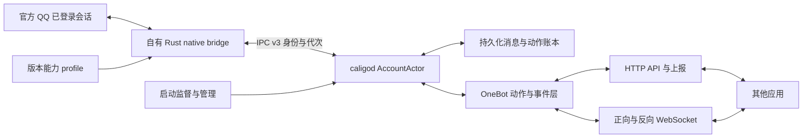

# Caligo 工程进度检查与 SnowLuma 能力对齐执行计划

> 日期：2026-10-09；任务：在现有自有 Rust 原生收发成果上，形成可持续运行的 OneBot V11 后端，再分阶段对齐 SnowLuma 的应用能力。
> 当前源码基线：`cb263ac953c1306696bb6ebcdedefec6e4ef22be`。检查开始时工作树干净；本轮只发布本计划，不实施业务代码、不操作 QQ。
> GitNexus：官方 runner 身份比较通过，使用已安装 1.6.12 distribution 执行一次 `analyze --index-only --pdg`；索引已刷新至本 HEAD，235 files / 12,850 nodes / 34,017 edges / 97 clusters / 297 flows。Rust 调用解析与 PDG 仍有限，结论以当前源码、测试及归档证据为准。
> 证据等级：`[verified]` 当前源码/文件或本轮测试确认；`[graph]` 图结果；`[inferred]` 基于证据的判断；`[assumed]` 待执行阶段验证。台账中的现场观察与本轮重新实测分开标注。
> 证据 provenance schema 2；global dirty digest：`5b58ad2732c406275bc917d18c91cf67b2ba3fcf3bc84af0c596b11dda542a12`；43 个排序引用路径，完整清单见 §11。仅本生成计划路径从全局 dirty digest 中排除。

## 1. 目标与阶段边界

下一交付目标是：**一个自有 Rust 常驻后端，以现有官方 QQ 会话为宿主，通过单一 bridge 正常收发私聊/群聊文本，并让真实 OneBot V11 应用直接使用；失败可诊断、重启可恢复、QQ 更新可判定支持范围。**

这延续“内核属于我们”的目标：QQ 提供已有登录会话与传输，自有 Rust 代码承担接入、编解码、生命周期、持久化、OneBot 和管理。SnowLuma 二进制不进入运行依赖。无需重做已有逆向，也不改成第三方 QQ 后端转接。

对齐分三级交付，不能用一个总百分比掩盖不同成熟度：

| 交付 | 用户能做什么 | 放行条件 |
|---|---|---|
| A：原生常驻文本闭环 | 一次接入后持续收发普通私聊、群聊文本；看到明确业务失败与 unknown | N0–N3、相应恢复/版本门通过 |
| B：OneBot 文本 MVP | 用 HTTP/WS 客户端接收事件、发送消息、查询消息与状态 | A + N4 + N5；真实应用互通通过 |
| C：SnowLuma 分阶段能力对齐 | @、回复、图片、更多媒体、查询/管理、多账号、管理界面与开发者入口 | N6–N8 按能力分别验收；未闭合能力继续明确拒绝 |

当前单版本范围仍为 QQ `9.9.33-52230`、Windows x64；`wrapper.node` SHA256 `63112ab9161e127f5f7e17998a7196e143808923fb54cbbf7b4e21426187a5f0`。这个摘要来自现有冻结报告/profile；本轮未读取当前运行 QQ 的加载模块，不把安装或历史摘要当作本轮运行实例准入。[verified]

## 2. 工程进度检查

与旧 `681434b` 基线相比，当前增加 53 个提交。上一轮 P0–P9 指南仍作为历史验收合同；本计划从已交付成果出发，采用 N0–N8 新编号。[verified]

| 能力/工作块 | 已完成证据 | 当前结论与下一缺项 |
|---|---|---|
| MSF 原生路线选择 | `k4-native-route-decision.md`、capability profile；`g2.rs/g3.rs` 实现 | 路线已定，可复用。生产准入仍需真实句柄、线程、ready、释放/回调寿命绑定 |
| 私聊普通文本发送 | 台账 r8/r9 记录送达与正常显示；r9 JSONL 有 adopt→submitted→done | 已有现场研究成果；本轮读取归档，不重新发送。尚无随请求返回的业务回执合同 |
| 群聊普通文本发送 | r18 台账记录送达与渲染；r18 JSONL 全部阶段成功 | 已有现场研究成果。已确定群路由嵌套 varint、群请求不带 ContentHead；迁入统一 codec |
| seq/random | r19/r19b/r19c 归档与台账；CLI 自动序号状态文件/bridge 随机值 | 研究工具已推进，不能继续说“完全未实现”；仍需生产原子分配、崩溃窗口、作用域和幂等验证 |
| 原生接收通知/正文关联 | G2 归档 161 行，含 msg_head、restore、done；相关性报告有真实正文命中 | 接收通知路径已打通。归档报告仍列 sender、chat_type、时间、稳定 ID 的记录内位置未定；标准业务事件完整映射需补证 |
| native ABI/handle/adapter | `native_abi.rs/native_handle.rs/native_msf.rs`；7 项 fake-ABI 合同测试本轮通过 | 有可复用基础。`MsfAdapter::new/submit_send` 的调用目前位于 fake 测试；现场 G3 使用另一路服务入口，不能直接认为此 adapter 已接入常驻 |
| IPC/daemon 恢复 | IPC v3 身份、epoch、跨连接未确认窗口；core 离线测试通过 | P3 已落地。旧 D9 Degraded 的摘要不再作为唯一问题锚点；仍需新原生常驻链的现场恢复验收 |
| core QQ codec | `qq_protocol/*`、合成 fixture 测试 | 合同骨架存在；字段仍 `FIELD_NUMBERS_VERIFIED=false`。发送编码结构与已成功 G3 不同；不能作为生产报文直接启用 |
| 业务响应消费者 | `response-consumer-scope.md:3,34-47` | 仅有范围和静态锚点；实现未开始，cookie/PB 关联、key 拼接、门控和对象 ABI 未闭合 |
| OneBot 服务 | `onebotd.rs` 旧 ARM/poll/shell 路线；默认构建拒绝 | 尚未形成新原生路径上的正式网络层。源码没有真实 HTTP listener；`build_send_args` 只拼参数，注释中的 HTTP API 不能算已实现 |
| 生命周期/版本化 | profile 对未知 hash、热换、停止限制有规则 | 文档规则存在；ready blocked、stop rejected。部分 gate 描述落后于新研究成果，需要逐项校准并变成执行前检查 |

关键依据：`g3.rs:827-880` 与 `qq_protocol/send.rs:11-77` 对比；`g3.rs:1214-1218` 明确“send returned (async)”和“verify delivery on peer”。因此 `g3s_done=true` 只证明研究调用阶段完成，业务送达来自台账中的对端观察，二者不能混用。[verified]

当前本轮测试结果：[verified]

| 命令 | 结果 | 覆盖边界 |
|---|---|---|
| `cargo test --workspace --features caligo-core/research --locked --offline` | **编译失败 E0061**，`g3.rs:1422` 仍以 6 参数调用现已 8 参数的 `encode_send_msg` | 全仓基线未绿；不因子集绿而宣称完整通过 |
| `cargo test -p caligo-core --features research --locked --offline` | 70 passed / 0 failed | codec、runtime、daemon、IPC、恢复等离线合同；无真实 QQ 业务回执证明 |
| `cargo test -p caligo-bridge --test native_adapter_contract --features research --locked --offline` | 7 passed / 0 failed | fake ABI、100 lifecycle、10k 调度、去重/迟到/隔离 |
| `cargo test -p caligo-cli --test legacy_gate --locked --offline` | 4 passed / 0 failed | 普通构建旧路线零进程访问拒绝 |
| `cargo test -p caligo-core --test onebotd_gate --locked --offline` | 2 passed / 0 failed | 普通构建旧 OneBot runner 拒绝；不启动 CLI 或访问 QQ |

构建与日志均在仓库外 `E:/stella/_reference/caligo-snowluma-parity-20261009/`，避免覆盖已部署研究 DLL。没有修改失败测试，也没有重新注入或干预 QQ。

**验收状态：原生文本研究里程碑已取得；生产常驻/OneBot MVP 尚未完成。** 原计划正式 G2/G3 要求各 10 私聊+10 群样本及完整身份/结果矩阵。现有“群 milestone CLOSED”应保留为历史事实，但本轮未找到足以替代整套矩阵的已归档验收；不凭一个 r18 或内存多处残留计算完成 20 次。

## 3. 目标架构与复用边界



保留四个 crate 的职责，暂不进行大规模拆仓：[inferred]

- `caligo-bridge`：唯一 QQ 原生交互面；原生数据在回调可用期拥有式复制，回调不等待网络/磁盘，不保留借用指针到异步 worker。
- `caligo-model`：规范化身份、消息段、动作状态、IPC schema。QQ native ID、OneBot message_id、request_id、echo、event_seq 分属不同空间。
- `caligo-core`：会话 actor、codec、journal/查询存储、请求关联、能力检查、OneBot 网络端点。网络重连不重新 bootstrap QQ。
- `caligo-cli`：启动/停止/状态/受控研究；研究 G2/G3 导出继续保留，正常消息发送走常驻服务。

native adapter 优先提供独立 NativeSession/Backend 边界，再把 resident 与 daemon worker 接到此边界。`MsfAdapter` 当前基于 transport-submit 与 callback manager 的假宿主合同，G3 实际经 MSF 服务入口且 MSF 层回调被置空；两者 ABI 和结果来源不能靠简单赋地址统一。[verified/inferred]

普通文本先沿已验证服务入口实现生产 adapter；原生 FFI 布局与寿命约束可复用，现场入口/结果消费需重新绑定。旧 JS/V8 owner pump 和 Transport slot7 插桩路线不重新作为主线。台账两次 slot7 插桩实例损失是负面证据，不能用“改成堆 vptr”自动解除禁用。

## 4. GitNexus 结果与影响范围

[verified] 旧索引停在 `681434b`，官方 `resolveAnalyzerRunnerIdentity/analyzerRunnerIdentitiesEqual` 对实际 `runnerIdentity` 比较为 true；刷新成功且未注入 AGENTS/CLAUDE 等文件。没有构建 analyzer 或更换其运行依赖。

[graph] `context MsfAdapter` 初次返回 Struct/Impl 歧义，使用 Struct UID 消歧成功；图只给出成员关系，未解析到生产 caller。`impact submit_send --direction upstream --depth 3 --include-tests` 返回 direct=0、risk=UNKNOWN，工具明确警告“零边不是未使用证明”。

[verified] 对源码 `.submit_send(` 和 `MsfAdapter::new` 的定向搜索补足限制：native_msf 的调用位于 `native_adapter_contract.rs`；core 同名 `AccountActor::submit_send` 是独立符号。计划需覆盖 fake 测试的真实直接依赖，而非依据零边删除 adapter。

手工核对的直接变化面：

| 主符号/边界 | 当前直接依赖 | 实施时必须处理 |
|---|---|---|
| `g3::encode_send_msg` | `g3_send_run`、g3 unit test | 提取普通文本结构；修复参数与过期结构断言；研究 @ 实验不自动纳入生产支持 |
| `MsfAdapter::submit_send` | native_adapter_contract 假宿主用例 | 保留原有合同；若改变真实后端入口，则分别测试正确 ABI，不能沿用 fake 回调作为业务回执 |
| `Resident::drain` | daemon_client run_worker/session_loop、旧宿主 adapter | 迁移 native runtime 接线，消除旧 owner pump 前提；核对 claim 与开始调用的语义 |
| `Daemon::serve_bridge` | AccountActor、IPC v3、EventAck、SendResult | 防旧连接/旧代次结果污染，身份与持久化失败不 ACK 成功 |
| `onebotd::main` | 旧 shell ARM/poll 与默认拒绝测试 | 保留旧拒绝覆盖或显式迁移；新网络入口只调用常驻 core |

本任务已由 R1/R2 与执行台账提供架构种子；未重复执行所有 clusters/processes 导航。索引有 97 clusters/297 flows，不把数量作为实际链路闭合证明。查询原始结果在仓库外 scratch，§11 保留必要结论。

## 5. PDG 与源码顺序约束

[graph] `impact --mode pdg` 在 line 257 未找到起始 block；修正至实际可执行 line 220 后找到 seed block，但没有 DISTINCT upstream-dependent block 或 affectedStatements。这说明本切片证据有限，不能声称已经由图证明全部安全条件。

以下为**源码确认的顺序约束**，不是编造的 PDG 边：[verified]

1. `native_msf.rs:218-234` links/thread/transport/command 检查先于原生调用；新生产 ready/profile/代次门必须放在同一前置边界。
2. `native_msf.rs:237-274` 创建 capture 后进入 FFI，随后登记 submitted；inline callback 可能在返回前完成。新增响应关联表必须在发起前建立，不能“先发送，后注册消费者”。同步失败的 cleanup 只在确证没有异步持有时执行。
3. `resident.rs:314-365` claim 先标 NativeStarted，再核对 adapter/invoke；`daemon_client` 中 submit Accepted 即可上报 NativeStarted。受理、已派发、已开始原生调用、业务成功必须分开表达；必要时调整消息或状态迁移，不让队列受理冒充调用结果。
4. `daemon.rs:451-471` 对 Event 先调用 actor，再 ACK；错误 currently `(wire_seq,true)` 会抑制窗口。N3 必须审查失败分类：重复可 ACK，持久化失败不可当重复成功吞掉，应关闭/保留重放并如实报告。
5. `runtime.rs:540-556` `Success {native_id:None}` 仍可进入 ConfirmedSuccess；`receipt.rs:69-74` 则明确缺稳定身份是 Unconfirmed。N2/N4 应统一新原生与 OneBot 边界合同，不能由 fake/旧结果绕过稳定身份要求。
6. `g3.rs:1214-1218` 发送函数返回不代表服务端接受或对端送达；正常 OneBot `status=ok` 必须依据已关联业务成功和持久化稳定消息身份。

## 6. 拟实施变更与 SnowLuma 对齐矩阵

SnowLuma 公开 README 在本轮核对包含 OneBot 动作/事件、HTTP/WS 双向接入、媒体/回复/提及/转发、多账号、WebUI、SDK、MCP；作为功能目录使用，不认为每项已由本轮逐 API 验证。[官方能力目录](https://github.com/SnowLuma/SnowLuma)

架构参考继续固定 R1/R2 的 v1.14.21 `9632b006385e603c9d9fe9150ab433e43792591f`；R2 已记录 v1.14.22 native 样本摘要相同，但不延伸为所有源码相同。本轮 GitHub commit API 返回限流，未取得当前 main 精确 SHA；启动 N6–N8 各块时冻结具体 API 文档/fixture 版本。[verified]

| 对齐面 | Caligo 当前 | 执行块 | 实现与验收策略 |
|---|---|---|---|
| 普通文本收发 | 现场研究通过、常驻整合待做 | N1–N3 | 单一 native backend；完整业务事件与回执 |
| 文本 OneBot | 旧 runner 默认关闭；新网络层缺失 | N4 | 标准消息事件与 send/get/status；一套动作层四种 transport |
| 身份/消息存储 | actor/journal 基础；完整查询 store 未交付 | N1/N4 | account+session+native identity 归一，持久整数 OneBot ID 映射，get_msg/reply 使用同一数据 |
| @ 与回复 | @ 多轮研究仍拒绝；reply 待做 | N6a | 先得到拒绝码与关联；@ 普通成员优先；reply 基于真实缓存，无正文不编造预览 |
| 图片 | 待做 | N6b | 文件输入→媒体上传→资源引用→消息发送；接收与发送分别支持 |
| 语音/视频/文件/转发/卡片 | 待做 | N6c | 各自协议、上传、资源寿命与事件合同独立门控 |
| 好友/群/成员查询 | 无已验收原生 backend | N7a | 身份服务及独立 query registry；不得返回空数组假成功 |
| notice/request/群管理 | 无已验收能力 | N7b | 先事件订阅，再明确有权限的动作，按账号支持矩阵暴露 |
| 多账号 | IPC/actor 身份基础存在 | N8a | 每账号独立状态、存储命名空间、native host、连接配置与回执 |
| WebUI/SDK/MCP | 待做 | N8b | 共享同一 action registry；界面直接显示能力/unknown/运行状态 |
| 版本适配 | 固定 hash/profile+研究方法 | N0/N3/N5 持续 | RVA 快路径+语义锚点+RTTI/PE 关系；每能力补证，新 hash 默认 unsupported |

计划主要新增/改进模块（这些新模块名是拟建接口，不是已存在事实）：

- bridge `native_session.rs/native_receive.rs/native_response.rs`：生产入口、接收拥有复制、消费者登记/注销/关联及回调寿命；复用 ABI/handle，禁止未确认 ABI 直接调用。
- shared codec：优先放 `caligo-model/src/qq_wire/`，由 core/bridge 共同依赖；从 `g3.rs` 提取已证普通文本，保持研究入口薄包装。core 现有 wire Reader/Writer 可迁移复用；避免 bridge 依赖 core 引入循环。
- core `message_store.rs/onebot/{actions,events,transport,...}`：身份索引、OneBot ID、动作与网络解耦，扩展 serde/HTTP/WS 依赖在实施阶段核对版本并锁定。
- profile admission：schema 区分 research_observed、lab_verified、resident_admitted、production_enabled，不能只把字符串改成 admitted。测试必须证明不支持时零 native 调用。
- supervisor：发现已登录目标、核对加载模块、单宿主单 bridge、管理 core 生命周期与凭据、同宿主 core 重启恢复。登录自动化不属于当前文本 MVP。

## 7. 逐块执行指南

### N0 — 冻结交接与修复测试基线（首先执行）

**输入：**本 HEAD、当前 DLL/QQ 模块摘要、旧计划 read-plan receipt 与台账。**动作：**

1. 新建执行台账，记录 HEAD/dirty、工具链、研究构建 feature、DLL 摘要/输出路径；整理 r9/r18/r19 成功及 @/slot7 失败样本的索引，不移动历史证据。
2. 修复 `g3.rs:1422` 单测参数回归，随后核对旧“顶层字段/路由”断言与普通文本真实结构；禁止只加参数让过期断言继续绿。
3. 完成未读源码的窄范围复核，尤其真实 FFI 字符串/vector/allocator 及 release；生成脱敏 wire fixture，保留类型、嵌套、长度和说明，不能用真实账号当测试常量。
4. 同步 profile 的事实描述与 README 当前阶段，但不升级未验收 gate；保留旧日期报告。明确旧 K4/P0–P9 哪些完成、哪些 partial。

**交付：**当前基线全仓测试绿、fixture 来源清单、能力矩阵。**通过：**research 与普通构建相关 gate 都通过；现场成功不被重置。**失败：**仅修测试/合同偏差，若报文断言矛盾回到已捕获样本复核，勿立刻新开 QQ 实例。

### N1 — 统一普通文本 wire 与完整接收事件

**动作：**把研究发送编码迁成共享 codec；朋友用已证 UID 路由，群用嵌套 varint route，群请求不带 ContentHead。element37 118B 常量在 r18 中有效不证明长期/所有会话有效；先限定当前支持域，并离线核对动态字段来源，不能把“服务器从不检查”写成合同。

接收侧以当前 G2 活监听点为起点，补齐记录级 sender、peer、chat_type、native ID、平台时间、正文与方向；不要从共享池里靠“发现某昵称/文本”组装业务事件。按实际通知类型做适配，借用 payload 在回调期复制成有界 owned 数据；坏地址和硬件异常不能靠 catch_unwind 兜底。

群 peer 是群码，sender 是成员；私聊 UIN↔UID 映射有来源和账号作用域。现有 `identity::classify_incoming` 一律 self_sent=false 是骨架，不足以给真实 self echo 分类。未知通知保留类型/计数，不能悄悄伪造文本或用本地时间填平台时间。

**交付：**shared codec、真实脱敏 golden fixtures、规范化 IncomingMessage。**通过：**每个支持样本身份/正文/时间/方向能独立对应同一记录；相同文本不同 ID 不去重；未知类型不串会话。**失败：**记录级字段拿不到就标记 receive mapping blocked，先补离线对象图证据；不要把 raw heads 数量算业务消息数。

### N2 — 闭合业务响应消费者（与 N1 的纯 codec 工作可独立推进）

从 `response-consumer-scope.md` 的 95d4e6/73bd6c 锚点出发，仅做有界合同验证：先解决 940588 门控串、97b0f/58e72 key 组合、请求 PB 中 msgUid/cookie 关系、消费者 A 实参 ABI 四项。现有文档中的“构造假 MsgRecord”是候选方案；完整 vtable/虚函数/allocator/持有关系未闭合之前不能照偏移直接构造并调用。

建议依次：离线追踪原生注册/响应/释放路径 → fake-ABI 重入与析构试验 → 安装受控消费者 → 一次普通文本正例与可重复业务拒绝负例 → 才迁入生产。禁用 slot7 插桩；响应消费点的观察路径仍须自己的生命周期证据。

建立 `(host_generation,session_generation,request_id,cookie)` 关联；发起之前预登记，inline/异步/重复/乱序/迟到回调都进入同一结果账本。持久化 seq/random 分配先于发起且记录保留，崩溃后的已开始发送不自动重发；counter 作用域由实际合同核对，不能只凭几个样本假定全会话无要求。

**交付：**可解释 retCode/errStr、稳定 native identity、失败与 unknown 三分类、释放/drain 合同；诊断字段默认脱敏。**通过：**成功、业务失败、无响应、重复/旧代次五类均可关联；原生返回/ACK 不能变成业务成功。**失败：**保持 field-proven-research，返回 unknown 或 explicit unsupported，停止 @ 盲试。达到有界证据仍无消费者寿命时按 §12 退回研究，不许写“最后一个缺陷一轮必收敛”。

### N3 — 单一 native 常驻 bridge 接入 caligod

**依赖：**N1 的普通文本/完整接收，N2 的结果合同；fake runtime 可提前做。**动作：**

1. 先实现 native session 层，明确 attach/adopt、ready、enqueue_send、receive/outcome channel、invalidate、close/quarantine。真实地址只在加载模块 hash/profile/锚点单候选/线程/代次通过后赋值。
2. 将 resident/daemon_client 从旧 JS/V8 pump 前提迁到 native 后端；无需普通消息逐条 CLI inject。复用 IPC v3、跨连接未确认窗口、actor/journal。
3. 明确 NativeStarted 发出的实际边界；callback 可早于 submit 返回，worker 的事件与结果顺序要可接受，不持锁跨 FFI，不在 QQ callback 阻塞 IPC。
4. EventAck 只在 journal 成功或已证明重复时推进；写盘失败/解码失败分别报告，不 ACK 成功吞数据。桥断开与 QQ 会话失效分开，core 重启不重新 bootstrap。
5. 一个宿主只驻一个 active bridge。研究多版本 DLL 共存是研究条件，生产重复启动返回已有实例或明确冲突；单纯覆盖文件不等于运行中热卸载。
6. 关闭先停止受理，标记旧代次，排空自有队列并如实分类在途 unknown；仅在原生 unregister/drain/cleanup 确证时 Clean，否则 Quarantined 保留必要代码/回调存储直到 QQ 退出。禁止 FreeLibrary 猜测回调已完结。

**交付：**无 UI 交互参与每条消息的 native resident＋core 闭环、单实例启动/状态/停止指南。**通过：**正式补齐或可验证复用 G2/G3 的各 10 私聊+10 群矩阵；发送含稳定 ID/业务结果与对端显示；接收含完整字段与独立真实记录。**失败：**按 native/codec/身份/IPC/持久化分层回 N1/N2/N3，保留部分成果，不反复整体注入。

### N4 — 身份存储和 OneBot V11 文本 MVP

先建立 account-scoped MessageStore：原生 identity/peer/sender/type/body/platform_time 与持久本地整数 message_id 的双向映射；本地整数仅是对已证原生记录的适配，不伪造 native ID。不在每次重启重新编号，也不由 request_id/hash 截断冒充消息 ID。沿用 journal 的 durable 语义；先补查询索引，是否改用 SQLite 在本块评估读写/迁移需求后决定，避免重写可靠账本。

第一批动作：`send_private_msg`、`send_group_msg`、`send_msg`、`get_msg`、`get_login_info`、`get_status`、`get_version_info`。前五依赖真实数据/回执，未支持动作明确失败。`get_status` 区分 daemon 活着、QQ attached、session ready、OneBot 已连接，不能固定 online=true。

发送支持字符串和标准数组文本段，转义/CQ 解析使用同一规范层，unsupported 段不静默丢弃；`echo` 原样返回任意 JSON 类型。接收提供 private/group 的标准消息事件和必要 sender/sub_type/time/self_id/message_id，缺必需真实字段时拒绝不完整标准事件并产生内部诊断。

网络顺序：HTTP API＋HTTP POST → 正向 WS `/api`、`/event`、`/` → 反向 WS Universal 及 API/Event 角色。使用一个 action registry 和事件 fanout，四种 transport 不复制 native 逻辑。鉴权、请求体上限、超时、慢客户端隔离、连接状态、重连间隔纳入配置；出站上报失败保留队列/游标，过载显式告警并有界。

OneBot 标准 WS 的 echo/path 语义参考 [正向 WebSocket](https://github.com/botuniverse/onebot-11/blob/master/communication/ws.md)，反向连接身份/角色与重连参考 [反向 WebSocket](https://github.com/botuniverse/onebot-11/blob/master/communication/ws-reverse.md)，HTTP 调用参考 [HTTP](https://github.com/botuniverse/onebot-11/blob/master/communication/http.md)。扩展错误字段/`_caligo/get_send_status` 必须单独文档化，不伪称 OneBot 标准。

业务回执超时返回“结果未知”的明确扩展信息和诊断 ID，不返回假的 `status=ok/message_id`，也不把 failed 解释为肯定未送达。内部 request_id 幂等只在同一键复用时成立；OneBot 重新发一个 action 或相同 echo 不自动具有幂等语义，必须在指南说明重试风险。

**交付：**可由普通构建启动的新 OneBot 入口（可以继续使用 onebotd 命名），纯网络层与旧 injection runner 有明确迁移边界。**通过：**真实应用通过网络发送并由 native 回执确认；另一端真实 QQ 消息作为规范事件进入应用。测试既覆盖 HTTP 又覆盖 WS，含重启后的 get_msg。**失败：**网络关闭不影响 QQ session；不能回退旧 shell send 来凑通路。

### N5 — 持续运行与版本更新验收（文本 MVP 发布门）

版本适配沿用 SnowLuma 的思路但增加明确支持合同：固定 hash/RVA 快路径 → 日志语义锚点、RTTI、PE 函数/引用关系筛选 → 独立验证 ABI/线程/寿命/codec → 能力级准入。resolver 找到地址只意味着候选定位；新 hash 一律先 unsupported。旧版本可用 profile 不被自动覆盖，新 profile 通过 LAB+现场矩阵后发布；QQ 更新后重新读取实际加载模块，旧地址全部失效。

做三类恢复：同宿主 bridge 管道断开、core 重启、QQ 退出/重启。前两者尽量保留原生会话且不重装 hook，后一类建立新 host/session 身份，禁止旧请求、映射或回调混入新实例。网络 WS 重连与 native session 恢复独立。

建议验收预算（设计目标，非已完成事实）：离线断链/重连 100 次，真实受控同宿主断链 10 次、core 重启 3 次、QQ 重启 2 次，2h 观察后 24h 单账号运行。对样本未漏/重复、在途结果、队列/RSS/句柄增长给出记录；不为凑次数重复损耗研究实例。若当前停止仍 Quarantined，输出该限制且不能宣称热卸载或无限反复 attach 已支持。

**交付：**恢复矩阵、安装/启动包、状态诊断、版本更新拒绝/回退指南。**通过：**无需编辑 PID/地址或每条消息交互；两种文本消息的实际应用互通完成；unknown 不重发；未知模块拒绝时零 native 调用。**失败：**发布仍标 preview，并明确哪个门未闭合。

### N6 — 消息段与媒体能力逐项对齐

N6a：先普通成员 @，后 @all；成功必须显示正确目标并拿到回执，权限不足有明确结果。reply 依赖真实持久消息与 native identity，缓存正文缺失不编造引文，自发/他发/重启后/跨会话引用都要验证。r20–r28b 属已知失败样本，r24 普通文本是控制组；保留控制组，先定位业务拒绝码再修改单一字段。

N6b：图片接收和发送分开验收，上传协议与发消息协议分开建模；文件大小/哈希/媒体 ID/有效期/资源删除可观测。上传成功不等于消息成功。输入 first local file，再 base64/URL；下载和解码有大小/时间限额、路径约束，不能让 QQ 回调执行文件 IO。

N6c：语音、视频、文件、合并转发、卡片、表情按实际需求排序。每项先明确 native/协议依赖、身份映射、权限、资源生命周期与失败码，然后实现 OneBot message segment。每项建议至少 5 个正例和坏输入/业务拒绝/超时反例；通过一项才提升相应 capability。禁止直接把 SnowLuma 的媒体 helper 或专有 native 组件放入产品依赖。

### N7 — 查询、通知和管理动作

先 `get_friend_list/get_group_list/get_group_member_info/get_group_member_list`，再撤回、群公告/禁言等权限动作、notice/request 事件。每个动作在 registry 记录输入/输出/QQ 后端/版本支持/回执/权限/测试状态；事件不是 UI 列表轮询伪造。查询失败不返回空列表成功；缓存标注更新时间与来源。

管理动作需真实权限和失败样本，低频串行验收；完整 SnowLuma API 对齐表由冻结文档逐项生成，分标准 OneBot 和 SnowLuma 扩展，避免仅按函数同名宣称兼容。

### N8 — 多账号、管理界面和开发者入口

N8a 两账号同时接收/发送，存储、凭据、host_generation、request_id namespace、连接配置独立；同一个 OneBot 整数 ID 的作用域在端点/账号中明确。一个账号更新/退出不使另一个重启；同账号多进程冲突有明确定义。

N8b CLI/轻量管理 API 先覆盖状态、日志、连接、能力、消息检索、动作调试；WebUI 在稳定 registry 上构建。SDK/MCP 调用相同动作层，不能新增直达 QQ 的旁路。安装包更新采用版本文件＋下次安全重启切换；atomic replace 仅保证磁盘发布，不承诺在 QQ 运行中热替换 DLL。跨平台接入和自动登录单列后续项目。

## 8. 测试策略与可执行验收

| 场景 | 输入/动作 | 必须观察的结果 | 阶段 |
|---|---|---|---|
| T01 全仓回归 | research/default 两构建 | 参数/断言无陈旧合同，门控不误开 | N0 |
| T02 群正确 wire | golden 群样本 | varint nested route，无 ContentHead，字节/语义符合来源 | N1 |
| T03 私聊与 Unicode | UID 路由、多元素、中英文/emoji/换行 | 完整 UTF-8，未知字段有界保留/计数 | N1 |
| T04 接收真实字段 | 私聊/群/自己发/未知通知 | sender≠peer 的语义、平台时间与 native identity 有来源 | N1 |
| T05 共享池与重复文本 | 同批不同记录、同文不同 native ID | 不串身份、不依正文去重 | N1 |
| T06 注册时序 | inline response、返回前回调 | 预登记可关联，结果只终结一次 | N2 |
| T07 业务正负例 | 接受、明确拒绝、无响应 | success/failure/unknown 独立，错误码不丢 | N2 |
| T08 回调代次 | 旧/重复/乱序/注销期间回调 | 旧结果只审计，资源不 UAF，不重开发送 | N2/N3 |
| T09 seq/random | 并发提交、重启、落盘失败 | 作用域正确、不重复分配；未确认项不自动重发 | N2 |
| T10 单 bridge | 同宿主第二次启动 | 复用/冲突，零重复 hook/bootstrap | N3 |
| T11 journaling | 写盘失败、ACK 丢失、worker 重连 | 不虚假推进 ACK；重放同一原生事件只发布一次 | N3 |
| T12 ready/unsupported | 未登录、模块 hash/锚点不符 | native_ops=0，明确原因，不凭非零 UIN ready | N3/N5 |
| T13 stop/inflight | 关闭与回调交错、排空失败 | 记录 unknown；Clean/Quarantined 如实，未证寿命不卸载 | N3 |
| T14 OneBot ID/store | 收发后查询、重启查询、账号冲突 | 整数映射稳定，原生 ID不截断，不跨会话找错消息 | N4 |
| T15 OneBot 协议 | HTTP/WS、echo 任意 JSON、非法段、鉴权失败 | 规范输出，错误显式，不能丢段后成功 | N4 |
| T16 外部客户端 | 真实应用接收/回复与 get_msg | 每条消息有同一 request/native/event 链证据 | N4 |
| T17 慢连接 | 上报失败、WS 断开、排队饱和 | 有界、可观测，native callback 无网络阻塞 | N4/N5 |
| T18 恢复/升级 | core/QQ 重启、新 hash、多候选 | 身份隔离，未知版本不调用，旧回执不串 | N5 |
| T19 @/reply | 正确对象、权限不足、缓存缺失、重启引用 | 真实显示与回执，不编造预览 | N6 |
| T20 媒体 | 上传失败/完成、资源过期/删除、坏文件 | 上传与消息结果分别记录，资源寿命有界 | N6 |
| T21 query/notice | 有数据、无权限/失败、重连重播 | 失败不是空列表成功，通知不虚构 | N7 |
| T22 多账号 | 同时运行、A 退出、B 持续 | 0 串账号；连接/状态/ID 作用域独立 | N8 |

当前可直接运行的验证命令如下。实施前保持 target-dir 与注入现场 DLL 分离；以下全部离线，不会操作真实 QQ：

```powershell
$env:CARGO_TARGET_DIR = 'E:/stella/_reference/caligo-snowluma-parity-20261009/cargo-target'
cargo test --workspace --features caligo-core/research --locked --offline
cargo test -p caligo-core --features research --locked --offline
cargo test -p caligo-bridge --test native_adapter_contract --features research --locked --offline
cargo test -p caligo-cli --test legacy_gate --locked --offline
cargo test -p caligo-core --test onebotd_gate --locked --offline
```

第一条在当前 HEAD 预期失败，N0 修复后要求通过。新测试路径/命令在实际新增时写入台账，不把规划中的测试当现有。网络 fixture 需标准客户端，真实 QQ 验收由执行者记录固定构建、样本 ID、方向、业务回执、对端观察、时间、原始证据摘要；自动生成 self event、raw memory 残留计数、阶段 done 都不能替代该矩阵。

## 9. 风险、影响与可观测性

最高风险是不同入口 ABI 混用、真实回调对象寿命未知、结果被误认为成功；其次是完整接收映射、IPC ACK/持久化失败、同宿主重复 bridge 和原生版本漂移。[inferred]

所有动作采用统一关联字段：account 的脱敏标识、host/session generation、request_id、native cookie、native ID、event_seq、profile hash、提交/响应耗时、结果分类。日志默认不写 auth token、完整私聊正文/好友表、原生内存块；现场 dump 继续放仓库外，公开证据用结构摘要/脱敏 fixture。

每个 native callback 有 items/bytes 上限与 dropped/unreadable/stale/duplicate 计数；有界队列不等于无损保证，超限必须显示 gap 并暂停对连续性作承诺。每个 network client 独立背压，不能拖住其他应用或 QQ 线程。

协议 schema 改动必须 versioned。是否从 IPC v3 增加原生回执/消息字段导致 v4，由 N1/N2 冻结实际 payload 后决定，不能悄悄给缺身份字段默认值来兼容旧消息。旧 journal reader 与新索引迁移要备份、兼容、明确失败，不清空账本消除错误。

迁移期一次只替换一个边界，保留普通文本控制组、旧研究程序和失败样本。新增 HTTP/WS 依赖在实施时检查官方文档并锁 Cargo.lock；本轮未安装或下载新的 Rust 依赖。

## 10. 预计文件变化与提交边界

下列新文件是建议落点，执行时可以按实际契约调整，须在台账注明，不表示当前已存在。

| 批次 | 文件/符号 | 目的 |
|---|---|---|
| C0 | `g3.rs` tests、`qq_text_codec.rs`、profile/README/执行台账 | 修基线、真实 fixture 与事实同步 |
| C1 | 新 `caligo-model/src/qq_wire/*`；core `qq_protocol/*`；bridge `g3.rs` | 共享有源 codec，研究包装复用 |
| C2 | 新 bridge `native_response.rs`；`native_abi.rs/native_handle.rs/native_msf.rs` | 真正业务响应、注册/寿命与结果合同 |
| C3 | 新 bridge `native_session.rs/native_receive.rs`；`resident.rs/daemon_client.rs/lib.rs` | 常驻 native 接线、ready/close/receive |
| C4 | model `ipc_v3.rs` 或明确新 IPC 文件；core `daemon.rs/runtime.rs/journal.rs` | 在途/ACK/持久化/关联与代次 |
| C5 | 新 core `message_store.rs/onebot/*`；`bin/onebotd.rs`；Cargo manifests/lock | 消息索引及统一 OneBot 网络层 |
| C6 | CLI 启动监督、profile admission 模块/测试、发布说明 | 生命周期与更新准入 |
| C7+ | 消息段/media/query registry、多账号、WebUI/SDK/MCP | 按 N6–N8 的独立能力逐项提交 |

C2 与 C3 的高风险 FFI 不与 WebUI/媒体大批代码混成一次提交。每批提交写明 wired 与 verified 的边界，新增能力只升级通过的 gate。先提交实现/离线合同，再独立提交现场验收记录；不要用提交标题“已闭合”替代证据。

## 11. 可复用实施上下文

下面 JSON 是执行代理/执行者可直接消费的上下文；证据 snapshot 由 skill 的 unmodified helper 生成，当前文件通过同 helper 安全写入。引用旧计划的 read-plan binding 为 `docs/plans/2026-10-08-gitnexus-plan-caligo-native-contract-recovery.md` / `sha256:12a30e3fd79516ba2df247cc4dfd2deee8d9d5b494bfbe2e1c26b929eaca0ca7`。

```json
{
  "implementation_context": {
    "task_summary": "保留现场原生文本成果，统一生产常驻 native 后端，完成 OneBot V11 文本 MVP，再按能力对齐 SnowLuma",
    "acceptance_criteria": [
      "N0全仓基线绿",
      "真实完整收包与业务回执",
      "单宿主单bridge与IPC恢复",
      "真实OneBot应用互通",
      "未知build零原生调用",
      "每能力独立验收无SnowLuma运行依赖"
    ],
    "evidence_provenance": {
      "schema_version": 2,
      "head_commit": "cb263ac953c1306696bb6ebcdedefec6e4ef22be",
      "generated_plan_path": "docs/plans/2026-10-09-gitnexus-plan-caligo-snowluma-capability-parity.md",
      "global_dirty_digest": {
        "algorithm": "sha256",
        "canonicalization": "gitnexus-evidence-provenance-v2 NUL-framed UTF-8 records",
        "value": "5b58ad2732c406275bc917d18c91cf67b2ba3fcf3bc84af0c596b11dda542a12"
      },
      "cited_path_manifest": [
        {
          "path": "Cargo.toml",
          "object_kind": {
            "head": "regular",
            "index": "regular",
            "worktree": "regular",
            "untracked": "absent"
          },
          "state": "clean",
          "rename_from": null,
          "rename_to": null,
          "head_digest": "sha256:5d8b0dd7e0e0ba73b0856e1f1b0b5a93e621a520aaab25a19dec5eb51045182f",
          "index_digest": "sha256:5d8b0dd7e0e0ba73b0856e1f1b0b5a93e621a520aaab25a19dec5eb51045182f",
          "worktree_digest": "sha256:5d8b0dd7e0e0ba73b0856e1f1b0b5a93e621a520aaab25a19dec5eb51045182f",
          "untracked_digest": "absent"
        },
        {
          "path": "README.md",
          "object_kind": {
            "head": "regular",
            "index": "regular",
            "worktree": "regular",
            "untracked": "absent"
          },
          "state": "clean",
          "rename_from": null,
          "rename_to": null,
          "head_digest": "sha256:60746abcc1a1f26e5f07ce8d0bfe344987e0debebbb2e96056bdfc6c37a8a530",
          "index_digest": "sha256:60746abcc1a1f26e5f07ce8d0bfe344987e0debebbb2e96056bdfc6c37a8a530",
          "worktree_digest": "sha256:60746abcc1a1f26e5f07ce8d0bfe344987e0debebbb2e96056bdfc6c37a8a530",
          "untracked_digest": "absent"
        },
        {
          "path": "crates/caligo-bridge/Cargo.toml",
          "object_kind": {
            "head": "regular",
            "index": "regular",
            "worktree": "regular",
            "untracked": "absent"
          },
          "state": "clean",
          "rename_from": null,
          "rename_to": null,
          "head_digest": "sha256:ee0b9863d453ee9c415d542cd3e0e95690fb2108d141f915a670e123978074ae",
          "index_digest": "sha256:ee0b9863d453ee9c415d542cd3e0e95690fb2108d141f915a670e123978074ae",
          "worktree_digest": "sha256:ee0b9863d453ee9c415d542cd3e0e95690fb2108d141f915a670e123978074ae",
          "untracked_digest": "absent"
        },
        {
          "path": "crates/caligo-bridge/src/daemon_client.rs",
          "object_kind": {
            "head": "regular",
            "index": "regular",
            "worktree": "regular",
            "untracked": "absent"
          },
          "state": "unstaged",
          "rename_from": null,
          "rename_to": null,
          "head_digest": "sha256:dee0db136ec9cb95607bdc4e860ee647d42b5562228be325d8dd4db7a992bf3d",
          "index_digest": "sha256:dee0db136ec9cb95607bdc4e860ee647d42b5562228be325d8dd4db7a992bf3d",
          "worktree_digest": "sha256:c14798cb7a91c99c747f83e3c4be24dee873d371860bfc8b0f8858cf94df45f6",
          "untracked_digest": "absent"
        },
        {
          "path": "crates/caligo-bridge/src/g2.rs",
          "object_kind": {
            "head": "regular",
            "index": "regular",
            "worktree": "regular",
            "untracked": "absent"
          },
          "state": "unstaged",
          "rename_from": null,
          "rename_to": null,
          "head_digest": "sha256:e2fc22ca7d2d5b6c0e31f6659630b4929d3f2319cefdbccbaad1c6aec1e535e2",
          "index_digest": "sha256:e2fc22ca7d2d5b6c0e31f6659630b4929d3f2319cefdbccbaad1c6aec1e535e2",
          "worktree_digest": "sha256:eee579126fa7297d89b6c649c7e6ecfa5330c8ae1a3622efdfcb2a551a034f05",
          "untracked_digest": "absent"
        },
        {
          "path": "crates/caligo-bridge/src/g3.rs",
          "object_kind": {
            "head": "regular",
            "index": "regular",
            "worktree": "regular",
            "untracked": "absent"
          },
          "state": "clean",
          "rename_from": null,
          "rename_to": null,
          "head_digest": "sha256:9f0820e12704da3d97dfca0589fa44382c5b16544aa1cf6753785f0e24c867bb",
          "index_digest": "sha256:9f0820e12704da3d97dfca0589fa44382c5b16544aa1cf6753785f0e24c867bb",
          "worktree_digest": "sha256:9f0820e12704da3d97dfca0589fa44382c5b16544aa1cf6753785f0e24c867bb",
          "untracked_digest": "absent"
        },
        {
          "path": "crates/caligo-bridge/src/host_adapter.rs",
          "object_kind": {
            "head": "regular",
            "index": "regular",
            "worktree": "regular",
            "untracked": "absent"
          },
          "state": "clean",
          "rename_from": null,
          "rename_to": null,
          "head_digest": "sha256:f47122de7e6648346e4be16ce56d15954198b512253d13eaa1f8b7b3f0355e37",
          "index_digest": "sha256:f47122de7e6648346e4be16ce56d15954198b512253d13eaa1f8b7b3f0355e37",
          "worktree_digest": "sha256:f47122de7e6648346e4be16ce56d15954198b512253d13eaa1f8b7b3f0355e37",
          "untracked_digest": "absent"
        },
        {
          "path": "crates/caligo-bridge/src/lib.rs",
          "object_kind": {
            "head": "regular",
            "index": "regular",
            "worktree": "regular",
            "untracked": "absent"
          },
          "state": "unstaged",
          "rename_from": null,
          "rename_to": null,
          "head_digest": "sha256:d0f367fe550a9b67e66969278bdecc1045ed3615f3659e8ce380b6cacd7a2f28",
          "index_digest": "sha256:d0f367fe550a9b67e66969278bdecc1045ed3615f3659e8ce380b6cacd7a2f28",
          "worktree_digest": "sha256:5d76b3c31536b7031e8d95af7d7c54c2177d78d91d9d16aa276595973541df81",
          "untracked_digest": "absent"
        },
        {
          "path": "crates/caligo-bridge/src/native_abi.rs",
          "object_kind": {
            "head": "regular",
            "index": "regular",
            "worktree": "regular",
            "untracked": "absent"
          },
          "state": "unstaged",
          "rename_from": null,
          "rename_to": null,
          "head_digest": "sha256:cd797c199b022951eb0520cfecf5f076d6ed05ebc50145c160bebce3059ce6f2",
          "index_digest": "sha256:cd797c199b022951eb0520cfecf5f076d6ed05ebc50145c160bebce3059ce6f2",
          "worktree_digest": "sha256:21cc2d37f3fda91842e1fb35850efc239a59ba603a7ebdd24d90b2d73ce847e2",
          "untracked_digest": "absent"
        },
        {
          "path": "crates/caligo-bridge/src/native_handle.rs",
          "object_kind": {
            "head": "regular",
            "index": "regular",
            "worktree": "regular",
            "untracked": "absent"
          },
          "state": "unstaged",
          "rename_from": null,
          "rename_to": null,
          "head_digest": "sha256:e149ad719ff438fa9cdedfee56f71f09311078b2b235207c8accfa29d7ba9dda",
          "index_digest": "sha256:e149ad719ff438fa9cdedfee56f71f09311078b2b235207c8accfa29d7ba9dda",
          "worktree_digest": "sha256:aed04427bb976d9901d0f1cc06005f40c2c0bc9dbda6802227c4fcd822679ff1",
          "untracked_digest": "absent"
        },
        {
          "path": "crates/caligo-bridge/src/native_msf.rs",
          "object_kind": {
            "head": "regular",
            "index": "regular",
            "worktree": "regular",
            "untracked": "absent"
          },
          "state": "unstaged",
          "rename_from": null,
          "rename_to": null,
          "head_digest": "sha256:3862567415b0a5195feac57f7c16f56fe5d5cb7a8a0e71447c7ecb13a7310416",
          "index_digest": "sha256:3862567415b0a5195feac57f7c16f56fe5d5cb7a8a0e71447c7ecb13a7310416",
          "worktree_digest": "sha256:76d732bd23f5ab14e65993bb03e21989a9474409cf9aa657f5ac178943036c1c",
          "untracked_digest": "absent"
        },
        {
          "path": "crates/caligo-bridge/src/resident.rs",
          "object_kind": {
            "head": "regular",
            "index": "regular",
            "worktree": "regular",
            "untracked": "absent"
          },
          "state": "unstaged",
          "rename_from": null,
          "rename_to": null,
          "head_digest": "sha256:c3123c27f16733955653fe5e5a0300230c8d8cb0a0d066ee882cdbb0a1717777",
          "index_digest": "sha256:c3123c27f16733955653fe5e5a0300230c8d8cb0a0d066ee882cdbb0a1717777",
          "worktree_digest": "sha256:84ca1729abea7eae9ddce2bd47eb7cff6c0c399346f778ae3582152097334649",
          "untracked_digest": "absent"
        },
        {
          "path": "crates/caligo-bridge/tests/native_adapter_contract.rs",
          "object_kind": {
            "head": "regular",
            "index": "regular",
            "worktree": "regular",
            "untracked": "absent"
          },
          "state": "unstaged",
          "rename_from": null,
          "rename_to": null,
          "head_digest": "sha256:148ddd43fe0feb04a8ff398dd2605c4937bd78561bd2811711335b9375a4d85d",
          "index_digest": "sha256:148ddd43fe0feb04a8ff398dd2605c4937bd78561bd2811711335b9375a4d85d",
          "worktree_digest": "sha256:6a2cc69323305499ffbbb181eb0bc2154905f5e2b3428691cfbbb0d8c9a695e4",
          "untracked_digest": "absent"
        },
        {
          "path": "crates/caligo-cli/src/winutil.rs",
          "object_kind": {
            "head": "regular",
            "index": "regular",
            "worktree": "regular",
            "untracked": "absent"
          },
          "state": "clean",
          "rename_from": null,
          "rename_to": null,
          "head_digest": "sha256:48fc21790668f1c26a10785accff3b66b7c666229b0f0a7326c9769e02d17eb7",
          "index_digest": "sha256:48fc21790668f1c26a10785accff3b66b7c666229b0f0a7326c9769e02d17eb7",
          "worktree_digest": "sha256:48fc21790668f1c26a10785accff3b66b7c666229b0f0a7326c9769e02d17eb7",
          "untracked_digest": "absent"
        },
        {
          "path": "crates/caligo-cli/tests/legacy_gate.rs",
          "object_kind": {
            "head": "regular",
            "index": "regular",
            "worktree": "regular",
            "untracked": "absent"
          },
          "state": "clean",
          "rename_from": null,
          "rename_to": null,
          "head_digest": "sha256:6da70d5b1f4054626447c522c6d69d913f544d167733cfe64a0356408a485de0",
          "index_digest": "sha256:6da70d5b1f4054626447c522c6d69d913f544d167733cfe64a0356408a485de0",
          "worktree_digest": "sha256:6da70d5b1f4054626447c522c6d69d913f544d167733cfe64a0356408a485de0",
          "untracked_digest": "absent"
        },
        {
          "path": "crates/caligo-core/Cargo.toml",
          "object_kind": {
            "head": "regular",
            "index": "regular",
            "worktree": "regular",
            "untracked": "absent"
          },
          "state": "clean",
          "rename_from": null,
          "rename_to": null,
          "head_digest": "sha256:30e902199836855dab806a3c196612e02abc8517dd402e41f6a35163951b9d4a",
          "index_digest": "sha256:30e902199836855dab806a3c196612e02abc8517dd402e41f6a35163951b9d4a",
          "worktree_digest": "sha256:30e902199836855dab806a3c196612e02abc8517dd402e41f6a35163951b9d4a",
          "untracked_digest": "absent"
        },
        {
          "path": "crates/caligo-core/src/bin/onebotd.rs",
          "object_kind": {
            "head": "regular",
            "index": "regular",
            "worktree": "regular",
            "untracked": "absent"
          },
          "state": "clean",
          "rename_from": null,
          "rename_to": null,
          "head_digest": "sha256:9b7c851fa9e15453cce787746907246bbe525363dff9392140a952fa503b44fa",
          "index_digest": "sha256:9b7c851fa9e15453cce787746907246bbe525363dff9392140a952fa503b44fa",
          "worktree_digest": "sha256:9b7c851fa9e15453cce787746907246bbe525363dff9392140a952fa503b44fa",
          "untracked_digest": "absent"
        },
        {
          "path": "crates/caligo-core/src/daemon.rs",
          "object_kind": {
            "head": "regular",
            "index": "regular",
            "worktree": "regular",
            "untracked": "absent"
          },
          "state": "unstaged",
          "rename_from": null,
          "rename_to": null,
          "head_digest": "sha256:1b75f4ef92e883c4d7eaba97b0c27ea6556845771c10217e9851c0f59bbd767d",
          "index_digest": "sha256:1b75f4ef92e883c4d7eaba97b0c27ea6556845771c10217e9851c0f59bbd767d",
          "worktree_digest": "sha256:e4e2a99c04ca1ae9a17ebaea29fa6f72c53d7c43747a081dad32f435b34dd883",
          "untracked_digest": "absent"
        },
        {
          "path": "crates/caligo-core/src/journal.rs",
          "object_kind": {
            "head": "regular",
            "index": "regular",
            "worktree": "regular",
            "untracked": "absent"
          },
          "state": "clean",
          "rename_from": null,
          "rename_to": null,
          "head_digest": "sha256:ea9f04b29ca51b5ef4abe9e3d8d9eece1c1a83d747bd9437d5f44788a08ea953",
          "index_digest": "sha256:ea9f04b29ca51b5ef4abe9e3d8d9eece1c1a83d747bd9437d5f44788a08ea953",
          "worktree_digest": "sha256:ea9f04b29ca51b5ef4abe9e3d8d9eece1c1a83d747bd9437d5f44788a08ea953",
          "untracked_digest": "absent"
        },
        {
          "path": "crates/caligo-core/src/qq_protocol/identity.rs",
          "object_kind": {
            "head": "regular",
            "index": "regular",
            "worktree": "regular",
            "untracked": "absent"
          },
          "state": "clean",
          "rename_from": null,
          "rename_to": null,
          "head_digest": "sha256:a72b5039a6f09a3d3e75e686230dc6080728ae805a3e33ac56f06130e87fdb9c",
          "index_digest": "sha256:a72b5039a6f09a3d3e75e686230dc6080728ae805a3e33ac56f06130e87fdb9c",
          "worktree_digest": "sha256:a72b5039a6f09a3d3e75e686230dc6080728ae805a3e33ac56f06130e87fdb9c",
          "untracked_digest": "absent"
        },
        {
          "path": "crates/caligo-core/src/qq_protocol/mod.rs",
          "object_kind": {
            "head": "regular",
            "index": "regular",
            "worktree": "regular",
            "untracked": "absent"
          },
          "state": "clean",
          "rename_from": null,
          "rename_to": null,
          "head_digest": "sha256:f187fd81e1b2018fe1a8d4dfdbe7a9f5dabd3bc62b0610c6093ec0d1742e3aee",
          "index_digest": "sha256:f187fd81e1b2018fe1a8d4dfdbe7a9f5dabd3bc62b0610c6093ec0d1742e3aee",
          "worktree_digest": "sha256:f187fd81e1b2018fe1a8d4dfdbe7a9f5dabd3bc62b0610c6093ec0d1742e3aee",
          "untracked_digest": "absent"
        },
        {
          "path": "crates/caligo-core/src/qq_protocol/receipt.rs",
          "object_kind": {
            "head": "regular",
            "index": "regular",
            "worktree": "regular",
            "untracked": "absent"
          },
          "state": "clean",
          "rename_from": null,
          "rename_to": null,
          "head_digest": "sha256:965760cb6a0b9c5e927b3ef8ad2fc4b778dbc699f6182a11cb499931c6aaa21b",
          "index_digest": "sha256:965760cb6a0b9c5e927b3ef8ad2fc4b778dbc699f6182a11cb499931c6aaa21b",
          "worktree_digest": "sha256:965760cb6a0b9c5e927b3ef8ad2fc4b778dbc699f6182a11cb499931c6aaa21b",
          "untracked_digest": "absent"
        },
        {
          "path": "crates/caligo-core/src/qq_protocol/recv.rs",
          "object_kind": {
            "head": "regular",
            "index": "regular",
            "worktree": "regular",
            "untracked": "absent"
          },
          "state": "unstaged",
          "rename_from": null,
          "rename_to": null,
          "head_digest": "sha256:d8df4dfa9df43d4e1438a533b8eae48e0cdd3d1442b0e6d688c445ca162b60e1",
          "index_digest": "sha256:d8df4dfa9df43d4e1438a533b8eae48e0cdd3d1442b0e6d688c445ca162b60e1",
          "worktree_digest": "sha256:a4f64d2dfdccf7555f9cb800a78d8ecab7c252dac0d62425dac00f486b9a35a2",
          "untracked_digest": "absent"
        },
        {
          "path": "crates/caligo-core/src/qq_protocol/send.rs",
          "object_kind": {
            "head": "regular",
            "index": "regular",
            "worktree": "regular",
            "untracked": "absent"
          },
          "state": "clean",
          "rename_from": null,
          "rename_to": null,
          "head_digest": "sha256:c28f814a0aaa12462109e0974f5ce32825a27be825c070ebaad3ea0532a2d3a0",
          "index_digest": "sha256:c28f814a0aaa12462109e0974f5ce32825a27be825c070ebaad3ea0532a2d3a0",
          "worktree_digest": "sha256:c28f814a0aaa12462109e0974f5ce32825a27be825c070ebaad3ea0532a2d3a0",
          "untracked_digest": "absent"
        },
        {
          "path": "crates/caligo-core/src/runtime.rs",
          "object_kind": {
            "head": "regular",
            "index": "regular",
            "worktree": "regular",
            "untracked": "absent"
          },
          "state": "clean",
          "rename_from": null,
          "rename_to": null,
          "head_digest": "sha256:1f88f1f6fd8800ffd8feadccafd0f670a2b29de2335eef20bece07163232e32c",
          "index_digest": "sha256:1f88f1f6fd8800ffd8feadccafd0f670a2b29de2335eef20bece07163232e32c",
          "worktree_digest": "sha256:1f88f1f6fd8800ffd8feadccafd0f670a2b29de2335eef20bece07163232e32c",
          "untracked_digest": "absent"
        },
        {
          "path": "crates/caligo-core/tests/onebotd_gate.rs",
          "object_kind": {
            "head": "regular",
            "index": "regular",
            "worktree": "regular",
            "untracked": "absent"
          },
          "state": "clean",
          "rename_from": null,
          "rename_to": null,
          "head_digest": "sha256:2ae9c4177ccd1faea06b6993ae29ea483ea72efc1533e6912bdceb106414e540",
          "index_digest": "sha256:2ae9c4177ccd1faea06b6993ae29ea483ea72efc1533e6912bdceb106414e540",
          "worktree_digest": "sha256:2ae9c4177ccd1faea06b6993ae29ea483ea72efc1533e6912bdceb106414e540",
          "untracked_digest": "absent"
        },
        {
          "path": "crates/caligo-core/tests/qq_text_codec.rs",
          "object_kind": {
            "head": "regular",
            "index": "regular",
            "worktree": "regular",
            "untracked": "absent"
          },
          "state": "clean",
          "rename_from": null,
          "rename_to": null,
          "head_digest": "sha256:29482e70c6d6a16cebe96aa3582a29f76794fc9e56ca4fe1765da6547e1e6470",
          "index_digest": "sha256:29482e70c6d6a16cebe96aa3582a29f76794fc9e56ca4fe1765da6547e1e6470",
          "worktree_digest": "sha256:29482e70c6d6a16cebe96aa3582a29f76794fc9e56ca4fe1765da6547e1e6470",
          "untracked_digest": "absent"
        },
        {
          "path": "crates/caligo-model/src/ipc_v3.rs",
          "object_kind": {
            "head": "regular",
            "index": "regular",
            "worktree": "regular",
            "untracked": "absent"
          },
          "state": "clean",
          "rename_from": null,
          "rename_to": null,
          "head_digest": "sha256:ce05295403e199526491abaaea85d01aaf0ee0ecce160626b92f42624322a026",
          "index_digest": "sha256:ce05295403e199526491abaaea85d01aaf0ee0ecce160626b92f42624322a026",
          "worktree_digest": "sha256:ce05295403e199526491abaaea85d01aaf0ee0ecce160626b92f42624322a026",
          "untracked_digest": "absent"
        },
        {
          "path": "docs/contracts/qq-9.9.33-52230.capability-profile.json",
          "object_kind": {
            "head": "regular",
            "index": "regular",
            "worktree": "regular",
            "untracked": "absent"
          },
          "state": "unstaged",
          "rename_from": null,
          "rename_to": null,
          "head_digest": "sha256:c9ebabeac2005ba3cfbb56eaf4f53d5588f476459fbc7821a65e8f9e3a8b9904",
          "index_digest": "sha256:c9ebabeac2005ba3cfbb56eaf4f53d5588f476459fbc7821a65e8f9e3a8b9904",
          "worktree_digest": "sha256:5572f1740a644ef8a4d95249dabd2f1ae641e185aab3712fda657189bd45d466",
          "untracked_digest": "absent"
        },
        {
          "path": "docs/execution/2026-10-08-native-contract-recovery/evidence/p6-g2/g2-run-21732-r4-p5.jsonl",
          "object_kind": {
            "head": "regular",
            "index": "regular",
            "worktree": "regular",
            "untracked": "absent"
          },
          "state": "clean",
          "rename_from": null,
          "rename_to": null,
          "head_digest": "sha256:5ad849c5306ccf65a13a61c60bfce1f9de73cb17687b76eed36ad62e0a99e5ee",
          "index_digest": "sha256:5ad849c5306ccf65a13a61c60bfce1f9de73cb17687b76eed36ad62e0a99e5ee",
          "worktree_digest": "sha256:5ad849c5306ccf65a13a61c60bfce1f9de73cb17687b76eed36ad62e0a99e5ee",
          "untracked_digest": "absent"
        },
        {
          "path": "docs/execution/2026-10-08-native-contract-recovery/evidence/p6-g2/p5-correlation-21732-r4.md",
          "object_kind": {
            "head": "regular",
            "index": "regular",
            "worktree": "regular",
            "untracked": "absent"
          },
          "state": "clean",
          "rename_from": null,
          "rename_to": null,
          "head_digest": "sha256:769c4b338b8eaa4ca5c58af62498fa7552aa89eaee7ee1845c987f3f02400d02",
          "index_digest": "sha256:769c4b338b8eaa4ca5c58af62498fa7552aa89eaee7ee1845c987f3f02400d02",
          "worktree_digest": "sha256:769c4b338b8eaa4ca5c58af62498fa7552aa89eaee7ee1845c987f3f02400d02",
          "untracked_digest": "absent"
        },
        {
          "path": "docs/execution/2026-10-08-native-contract-recovery/evidence/p6-g3/g3-send-24316-r9.jsonl",
          "object_kind": {
            "head": "regular",
            "index": "regular",
            "worktree": "regular",
            "untracked": "absent"
          },
          "state": "clean",
          "rename_from": null,
          "rename_to": null,
          "head_digest": "sha256:ab95910b34bb2b2014abcfca2722146ad9a63cfd92c2ed06b915cd771126c252",
          "index_digest": "sha256:ab95910b34bb2b2014abcfca2722146ad9a63cfd92c2ed06b915cd771126c252",
          "worktree_digest": "sha256:ab95910b34bb2b2014abcfca2722146ad9a63cfd92c2ed06b915cd771126c252",
          "untracked_digest": "absent"
        },
        {
          "path": "docs/execution/2026-10-08-native-contract-recovery/evidence/p6-g3/g3-send-27624-r18.jsonl",
          "object_kind": {
            "head": "regular",
            "index": "regular",
            "worktree": "regular",
            "untracked": "absent"
          },
          "state": "clean",
          "rename_from": null,
          "rename_to": null,
          "head_digest": "sha256:675b45ccbc698bf3d6b85cf92b5c5c2395537fc202ea1e925d3bc4a8ec5cfa73",
          "index_digest": "sha256:675b45ccbc698bf3d6b85cf92b5c5c2395537fc202ea1e925d3bc4a8ec5cfa73",
          "worktree_digest": "sha256:675b45ccbc698bf3d6b85cf92b5c5c2395537fc202ea1e925d3bc4a8ec5cfa73",
          "untracked_digest": "absent"
        },
        {
          "path": "docs/execution/2026-10-08-native-contract-recovery/evidence/p6-g3/g3-send-27624-r19.jsonl",
          "object_kind": {
            "head": "regular",
            "index": "regular",
            "worktree": "regular",
            "untracked": "absent"
          },
          "state": "clean",
          "rename_from": null,
          "rename_to": null,
          "head_digest": "sha256:6c6bcb8d7a1b4c19f56a6953989e16dddfa1653d6dce342ceae749be97ec7be8",
          "index_digest": "sha256:6c6bcb8d7a1b4c19f56a6953989e16dddfa1653d6dce342ceae749be97ec7be8",
          "worktree_digest": "sha256:6c6bcb8d7a1b4c19f56a6953989e16dddfa1653d6dce342ceae749be97ec7be8",
          "untracked_digest": "absent"
        },
        {
          "path": "docs/execution/2026-10-08-native-contract-recovery/evidence/p6-g3/g3-send-27624-r19b.jsonl",
          "object_kind": {
            "head": "regular",
            "index": "regular",
            "worktree": "regular",
            "untracked": "absent"
          },
          "state": "clean",
          "rename_from": null,
          "rename_to": null,
          "head_digest": "sha256:9c7efb63abfad599cfc3fe0ddc2bf0813b11e89e2ca26eee2c4a14c8c0f1c84d",
          "index_digest": "sha256:9c7efb63abfad599cfc3fe0ddc2bf0813b11e89e2ca26eee2c4a14c8c0f1c84d",
          "worktree_digest": "sha256:9c7efb63abfad599cfc3fe0ddc2bf0813b11e89e2ca26eee2c4a14c8c0f1c84d",
          "untracked_digest": "absent"
        },
        {
          "path": "docs/execution/2026-10-08-native-contract-recovery/evidence/p6-g3/g3-send-27624-r19c.jsonl",
          "object_kind": {
            "head": "regular",
            "index": "regular",
            "worktree": "regular",
            "untracked": "absent"
          },
          "state": "clean",
          "rename_from": null,
          "rename_to": null,
          "head_digest": "sha256:72136df134d8646fb0f20b6d561ac615ed4b255604ff8204c5f3e3147e2f4274",
          "index_digest": "sha256:72136df134d8646fb0f20b6d561ac615ed4b255604ff8204c5f3e3147e2f4274",
          "worktree_digest": "sha256:72136df134d8646fb0f20b6d561ac615ed4b255604ff8204c5f3e3147e2f4274",
          "untracked_digest": "absent"
        },
        {
          "path": "docs/execution/2026-10-08-native-contract-recovery/ledger.md",
          "object_kind": {
            "head": "regular",
            "index": "regular",
            "worktree": "regular",
            "untracked": "absent"
          },
          "state": "clean",
          "rename_from": null,
          "rename_to": null,
          "head_digest": "sha256:042a54cffacf13b5a4c0884f671a70b21d769fcd70dee4575e00691e25500063",
          "index_digest": "sha256:042a54cffacf13b5a4c0884f671a70b21d769fcd70dee4575e00691e25500063",
          "worktree_digest": "sha256:042a54cffacf13b5a4c0884f671a70b21d769fcd70dee4575e00691e25500063",
          "untracked_digest": "absent"
        },
        {
          "path": "docs/plans/2026-10-08-gitnexus-plan-caligo-native-contract-recovery.md",
          "object_kind": {
            "head": "regular",
            "index": "regular",
            "worktree": "regular",
            "untracked": "absent"
          },
          "state": "unstaged",
          "rename_from": null,
          "rename_to": null,
          "head_digest": "sha256:7ab3432611255bb106205d3dff1a1731560f46b2ab36bdf05ee95f181da184a2",
          "index_digest": "sha256:7ab3432611255bb106205d3dff1a1731560f46b2ab36bdf05ee95f181da184a2",
          "worktree_digest": "sha256:12a30e3fd79516ba2df247cc4dfd2deee8d9d5b494bfbe2e1c26b929eaca0ca7",
          "untracked_digest": "absent"
        },
        {
          "path": "docs/research/2026-10-08-qq-native-contract-and-version-adaptation.md",
          "object_kind": {
            "head": "regular",
            "index": "regular",
            "worktree": "regular",
            "untracked": "absent"
          },
          "state": "clean",
          "rename_from": null,
          "rename_to": null,
          "head_digest": "sha256:95c24bf2ca89b3ff3fca47326582e6cabadccb0743d408072786be828f0d6562",
          "index_digest": "sha256:95c24bf2ca89b3ff3fca47326582e6cabadccb0743d408072786be828f0d6562",
          "worktree_digest": "sha256:95c24bf2ca89b3ff3fca47326582e6cabadccb0743d408072786be828f0d6562",
          "untracked_digest": "absent"
        },
        {
          "path": "docs/research/2026-10-08-snowluma-native-workflow-reconstruction.md",
          "object_kind": {
            "head": "regular",
            "index": "regular",
            "worktree": "regular",
            "untracked": "absent"
          },
          "state": "clean",
          "rename_from": null,
          "rename_to": null,
          "head_digest": "sha256:7c18d6efe5f6f9c7439d958a6dac895e54f8d77d7906b320f81f9f0c8b3b5068",
          "index_digest": "sha256:7c18d6efe5f6f9c7439d958a6dac895e54f8d77d7906b320f81f9f0c8b3b5068",
          "worktree_digest": "sha256:7c18d6efe5f6f9c7439d958a6dac895e54f8d77d7906b320f81f9f0c8b3b5068",
          "untracked_digest": "absent"
        },
        {
          "path": "docs/research/k4-execution-scope.md",
          "object_kind": {
            "head": "regular",
            "index": "regular",
            "worktree": "regular",
            "untracked": "absent"
          },
          "state": "clean",
          "rename_from": null,
          "rename_to": null,
          "head_digest": "sha256:573c6bf503bf995d3cc83d60b9abfb6ae41b27b1fbf94c6c42d9efa6130881a0",
          "index_digest": "sha256:573c6bf503bf995d3cc83d60b9abfb6ae41b27b1fbf94c6c42d9efa6130881a0",
          "worktree_digest": "sha256:573c6bf503bf995d3cc83d60b9abfb6ae41b27b1fbf94c6c42d9efa6130881a0",
          "untracked_digest": "absent"
        },
        {
          "path": "docs/research/k4-native-route-decision.md",
          "object_kind": {
            "head": "regular",
            "index": "regular",
            "worktree": "regular",
            "untracked": "absent"
          },
          "state": "clean",
          "rename_from": null,
          "rename_to": null,
          "head_digest": "sha256:24c985362439cff0a3696c523b6275490319570fc11a6a0822f716c27d4f81a5",
          "index_digest": "sha256:24c985362439cff0a3696c523b6275490319570fc11a6a0822f716c27d4f81a5",
          "worktree_digest": "sha256:24c985362439cff0a3696c523b6275490319570fc11a6a0822f716c27d4f81a5",
          "untracked_digest": "absent"
        },
        {
          "path": "docs/research/response-consumer-scope.md",
          "object_kind": {
            "head": "regular",
            "index": "regular",
            "worktree": "regular",
            "untracked": "absent"
          },
          "state": "clean",
          "rename_from": null,
          "rename_to": null,
          "head_digest": "sha256:cab10ce9bae1202d34d6dcc2f01a3a58a9e4f8baae98f2184b586a9fed264a75",
          "index_digest": "sha256:cab10ce9bae1202d34d6dcc2f01a3a58a9e4f8baae98f2184b586a9fed264a75",
          "worktree_digest": "sha256:cab10ce9bae1202d34d6dcc2f01a3a58a9e4f8baae98f2184b586a9fed264a75",
          "untracked_digest": "absent"
        }
      ]
    },
    "primary_symbols": [
      {
        "symbol": "encode_send_msg",
        "file": "crates/caligo-bridge/src/g3.rs",
        "lines": "827-1008,1422",
        "role": "已证编码迁移/测试回归"
      },
      {
        "symbol": "MsfAdapter::submit_send",
        "file": "crates/caligo-bridge/src/native_msf.rs",
        "lines": "218-274",
        "role": "fake与真实ABI分离/预登记回调"
      },
      {
        "symbol": "Resident::drain",
        "file": "crates/caligo-bridge/src/resident.rs",
        "lines": "314-365",
        "role": "常驻native执行边界"
      },
      {
        "symbol": "Daemon::serve_bridge",
        "file": "crates/caligo-core/src/daemon.rs",
        "lines": "288-355,421-476",
        "role": "身份/ACK/回执"
      },
      {
        "symbol": "onebotd::main",
        "file": "crates/caligo-core/src/bin/onebotd.rs",
        "lines": "21-109",
        "role": "旧网络runner替换"
      }
    ],
    "related_symbols": [
      {
        "symbol": "parse_send_receipt",
        "relationship": "receipt contract",
        "relevance": "字段未验证，成功缺身份分类不同"
      },
      {
        "symbol": "AccountActor::bridge_result",
        "relationship": "result consumer",
        "relevance": "Success(None)仍可confirmed，OneBot需严格边界"
      },
      {
        "symbol": "run_worker/session_loop",
        "relationship": "resident/IPC worker",
        "relevance": "保留跨连接窗口，修改native接线"
      }
    ],
    "execution_path": [
      "当前研究:CLI→g3_send_run→MSFService→异步发送→人工/对端观察",
      "目标:OneBot action→AccountActor journal→IPC→NativeSession预登记→原生发起→业务回执→journal→标准响应",
      "目标接收:QQ通知→owned记录→IPC→actor持久化/ACK→store→标准事件"
    ],
    "pdg_constraints": [],
    "pdg_limitation": "statement seed line220 found; no affectedStatements; ordering constraints are source-derived section5",
    "architectural_patterns": [
      {
        "pattern": "account actor+durable journal",
        "example_location": "crates/caligo-core/src/runtime.rs",
        "usage_guidance": "复用去重与unknown恢复，新增查询索引不清账本"
      },
      {
        "pattern": "native ownership+generation",
        "example_location": "crates/caligo-bridge/src/native_handle.rs",
        "usage_guidance": "释放未证则quarantine，禁止强制卸载"
      }
    ],
    "files_to_modify": [
      {
        "file": "crates/caligo-bridge/src/g3.rs",
        "symbols": [],
        "intended_change": "修复回归并提取普通文本codec"
      },
      {
        "file": "crates/caligo-model/src/qq_wire/",
        "symbols": [],
        "intended_change": "拟新增共享codec"
      },
      {
        "file": "crates/caligo-bridge/src/native_response.rs",
        "symbols": [],
        "intended_change": "拟新增真实响应关联/寿命"
      },
      {
        "file": "crates/caligo-bridge/src/native_session.rs",
        "symbols": [],
        "intended_change": "拟新增生产native后端"
      },
      {
        "file": "crates/caligo-bridge/src/native_receive.rs",
        "symbols": [],
        "intended_change": "拟新增owned接收映射"
      },
      {
        "file": "crates/caligo-bridge/src/resident.rs",
        "symbols": [],
        "intended_change": "native常驻执行"
      },
      {
        "file": "crates/caligo-bridge/src/daemon_client.rs",
        "symbols": [],
        "intended_change": "原生事件/结果接线"
      },
      {
        "file": "crates/caligo-core/src/daemon.rs",
        "symbols": [],
        "intended_change": "ACK失败/身份/结果"
      },
      {
        "file": "crates/caligo-core/src/runtime.rs",
        "symbols": [],
        "intended_change": "业务三分类边界"
      },
      {
        "file": "crates/caligo-core/src/message_store.rs",
        "symbols": [],
        "intended_change": "拟新增稳定ID查询索引"
      },
      {
        "file": "crates/caligo-core/src/onebot/",
        "symbols": [],
        "intended_change": "拟新增动作与四种transport"
      },
      {
        "file": "crates/caligo-core/src/bin/onebotd.rs",
        "symbols": [],
        "intended_change": "迁移旧runner"
      },
      {
        "file": "docs/contracts/qq-9.9.33-52230.capability-profile.json",
        "symbols": [],
        "intended_change": "事实同步+机器准入"
      }
    ],
    "tests": [
      {
        "file": "crates/caligo-core/tests/qq_text_codec.rs",
        "scenarios": [
          "golden私聊/群wire",
          "owned接收身份",
          "Unicode/unknown字段"
        ]
      },
      {
        "file": "crates/caligo-bridge/tests/native_adapter_contract.rs",
        "scenarios": [
          "ABI重入/迟到/代次",
          "真实backend另加合同，不沿用假的业务成功"
        ]
      },
      {
        "file": "crates/caligo-cli/tests/legacy_gate.rs",
        "scenarios": [
          "默认门零进程访问拒绝"
        ]
      },
      {
        "file": "crates/caligo-core/tests/onebotd_gate.rs",
        "scenarios": [
          "旧runner拒绝/新入口迁移明确"
        ]
      },
      {
        "file": "crates/caligo-core/tests/onebot_contract.rs",
        "scenarios": [
          "拟新增:echo/auth/ID/get_msg/网络恢复/unknown"
        ]
      }
    ],
    "verification_commands": [
      "cargo test --workspace --features caligo-core/research --locked --offline",
      "cargo test -p caligo-core --features research --locked --offline",
      "cargo test -p caligo-bridge --test native_adapter_contract --features research --locked --offline",
      "cargo test -p caligo-cli --test legacy_gate --locked --offline",
      "cargo test -p caligo-core --test onebotd_gate --locked --offline"
    ],
    "risks": [
      "ABI入口混用",
      "真实callback寿命未闭合",
      "完整接收字段未证",
      "误ACK写盘失败",
      "重复bridge/unknown重发",
      "模块ABI漂移"
    ],
    "assumptions": [
      "额外未归档静默收发成果在N0核对wired路径",
      "seq/element37/nativeID稳定域在N1/N2验证",
      "试点OneBot应用在N4记录版本/transport"
    ],
    "open_questions": [
      "940588门控",
      "97b0f/58e72 key格式",
      "msgUid PB/cookie关联",
      "response consumer A实参ABI/释放",
      "完整接收记录字段",
      "关闭drain与当前Quarantined边界",
      "当前SnowLuma精确mainSHA/API文档冻结"
    ],
    "avoid": [
      "Do not repeat full repository discovery",
      "Do not overwrite historical research evidence",
      "Do not run live QQ probes during planning",
      "Do not use slot7 interception rejected by two fatal field cases",
      "Do not treat g3s_done/transport ACK as business success",
      "Do not auto-resend delivery_unknown",
      "Do not hot-unload callback code with unproven drain",
      "Do not introduce SnowLuma runtime dependency",
      "Do not promote profile gate by prose alone"
    ]
  }
}
```

## 12. 未决问题、前提与明确延后项

1. [assumed] 用户已有现场“静默收发”可能包含未归档的新服务/脚本。本轮结论绑定当前 HEAD、已归档文件和离线测试，执行 N0 时将额外现场成果补进索引；无需重做已有成功流程，但必须给出 wired path 才能升级生产状态。
2. [assumed] 生产调用 732A80 的线程/allocator/句柄释放与 callback 持有是否均可复用现有研究合同：N2/N3 逐项从固定 build 核对；fake 绿不能替代实参寿命。
3. [verified] 响应 consumer 的四项具体未知见 N2；未闭合则保持 research 支持，先不扩 @。替代结果策略也必须有稳定关联和独立真实来源，不能从局部返回/内存残留凑成功。
4. [verified] 接收相关性报告仍有字段位置待办；若后续完整解析已在仓库外实现，N0 给出源文件、binary hash、单条记录证明和调用路径，避免重写。
5. [assumed] 序号作用域、元素37 动态位、native ID 稳定性不能由少量成功样本概括；N1/N2 需要明确可验证合同和目前限制。
6. [verified] GitNexus Rust caller/PDG 输出有限；本计划没有把 UNKNOWN 当低风险。后续改核心边界仍需 source/test/runtime 三方核对。
7. [verified] 当前 SnowLuma main SHA 因 API 限流未固定；当前 README 是功能目录，固定旧样本用于架构参考。完整 API 比较在 N7 冻结官方动作文档后逐项核对，不能使用无法访问的文档链接作已核验依据。
8. [assumed] 试点应用可使用任一标准 OneBot 客户端；N4 起步时记录具体应用版本和 transport。如果已有下游仅支持 reverse WS，就优先实现该 adapter，不改变共享 action/event 层。
9. 明确延后：跨平台、自动登录/二维码交互、无合同热卸载/热换 ABI、完整 WebUI 先行、一次性复制全部 SnowLuma 扩展 API。新功能依赖与版本选择在实施时核对；本轮不作未经验证的精确工期保证。

## 13. 完成定义与执行起点

**交付 A 完成：**N0 测试全绿；普通文本 shared codec 与记录级接收身份闭合；响应有稳定关联与业务三分类；单一 native bridge 连接 caligod，正式 G2/G3 矩阵及安全关闭/隔离语义有证据。历史研究成果保留且不重复投入。

**交付 B 完成：**以上能力从正常启动入口可用，真实 OneBot 应用通过 HTTP/WS 正常收发与 get_msg；unknown/unsupported/未 ready 返回正确；重启、断链、慢客户端、版本更新拒绝通过，24h 单账号运行有验收。运行依赖不包含 SnowLuma/NapCat 等第三方 QQ 后端。

**交付 C 完成：**冻结版本的功能对齐表每项有 implemented/wired/lab/field/support-version 状态；每项媒体/query/admin 与多账号入口按 N6–N8 独立放行。未支持能力有明确拒绝，不以空值/伪成功补齐。

立即执行顺序：**N0 修测试与证据交接 → N1 统一真实文本与接收映射，N2 闭合回执 → N3 常驻整合 → N4 OneBot → N5 MVP 发布验收 → N6–N8 扩能力。** 第一轮只收敛 N0 和 N1/N2 的可验证合同，不再以反复 @ 注入或“再换一个实例应该能好”作为推进方式。
