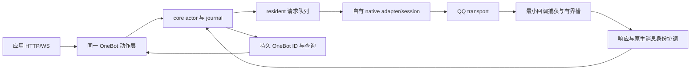

# Caligo N4 解阻与响应恢复执行计划

> Task：以仓库现有原生研究为基础，恢复自有 Rust bridge/core 的请求与响应闭环，再完成 OneBot 文本接口。
> Evidence verified at commit `0f5b4834dc17534083a0c503b2a0223ab44e3451`；GitNexus 本轮 `analyze --index-only --pdg` 已刷新。开始时存在用户未提交的文档 harness，Rust 未修改。
> Evidence provenance schema 2；global dirty digest `298284fa9c9bade8a54b6baccf9cb982f6f5d27d399b2cac701604f3d82daeff`；cited-path manifest 39 个排序条目；仅本计划路径排除在全局 digest 外。
> 本文是计划。2026-10-11 的现场硬停、未知构建拒绝、unknown 不重发及未证寿命不卸载继续有效。

## 1. 目标与本轮范围

用户希望理解 N4 为什么卡住，以及如何继续完成属于自己的 SnowLuma 同类能力。本轮只研究、验证合成反例和制定指南，不修产品代码、不操作 QQ；feat-005/006 保持 blocked，生产 NOT READY。

**建议首先执行 N4-R1：请求身份与结果合同恢复。** 该块能完全在假宿主与本机 IPC 中完成。不是重新寻找 send 地址，也不是重复注入 QQ。R1 是下一次实施的唯一 active feature；后面的 R2–R6 是依赖顺序，不能同时展开。

本计划细化原 N0–N8 计划的 N2/N3 依赖和 N4，不撤销原 G2/G3、T14–T17、N5 完成门。普通文本仍是首批范围；@、图片、文件、管理 API、其他 QQ 构建与自动适配发布明确延后。

## 2. 现状与阻塞的重新定位

[verified] 台账（四十）记录 consumer 接线，（四十一）记录 resident 事件上行、重连与发送进入账本 `NativeStarted`，随后实例退出，`consumer_result=0`；没有完整响应回程与稳定身份成功证据。该样本证明到达账本阶段，不能单靠它证明实际 native 已发出：当前 daemon_client 在 resident.submit 返回 Accepted 时就上报 NativeStarted（daemon_client.rs:829–843），真正 native_op 在 Resident::drain 中稍后执行。

[verified] 响应链存在一个确定的身份断点：

```text
daemon request_id=R
  -> OwnedRequest::SendText { request_id: R }
  -> HostOp::SendText { chat_type, peer_uid, text }   // request_id 丢失
  -> NativeSession 注册 native-resident-N
  -> cookie 回程返回 native-resident-N
  -> Resident 查不到 R，仍转发 native-resident-N
  -> AccountActor 只审计未知请求；R 留在等待状态
```

[verified] 对应源码：resident.rs:328；host_adapter.rs:25；native_resident.rs:404–408、303–319；resident.rs:491–495；runtime.rs:552–556。本轮假 adapter 反例证明 resident 会转发内部 ID；没有用真 QQ 验证 adapter，本结论的 native ID 生成部分由源码确认。

[verified] 第二个确定断点是结果语义：BusinessAccepted → Success(None) → IPC Success(None) → NativeResult::Success(None) → ConfirmedSuccess(None)。注释虽禁止，类型与迁移没有执行这个约束。位置：native_resident.rs:305–316、daemon_client.rs:711、daemon.rs:442、runtime.rs:544。

[verified] N4 网络层也有确定缺陷：send_private_msg 校验 user_id 后丢弃它；HTTP 分包时 onebot_http.rs:111 的 usize 减法下溢。本轮两项反例复现。它们不是 QQ 死亡原因，却会阻止实际应用互通。

[inferred] 因此 N4 不是“最后一个重连时序问题”。即使 QQ 正常存活并回调，现有链路仍无法正确闭环；优先处理已确认缺陷，避免现场样本被错误账本与日志掩盖。

## 3. 相关架构与复用边界

复用当前 AccountActor/journal、Resident 队列与锁序、NativeSession/ResponseLedger、native wire codec、daemon IPC、OneBot 动作层。SnowLuma 只提供静态交互规格参照；不接其 backend，不恢复旧 onebotd 注入/poll runner 作为产品入口。



必须明确区分五个键：原始 request_id、callback cookie、本地 mid、QQ 原生消息身份、OneBot int32 message_id。前三项都不能冒充 QQ message ID。连接 epoch、host generation、session generation 与账号共同约束关联；同一 QQ 宿主的 pipe 重连不等于新 native 会话。

[verified] 旧寿命研究确认 getter 获取强引用、callback 在 arg5 move-like 管理对象中移动；732A80 深复制 command/body、移动 delegate。当前 g3_ops 的“getter 零副作用”和“buf/cb 一并转移”的注释不能替代所有权合同。参考 lifetime-contract §§3/6 和固定版本研究 §send；精确输入容器和异常清理仍须逐项复核。

[verified] 当前 native_resident 仅群聊分支，chat_type!=2 明确拒绝；历史私聊研究成功不能自动算常驻私聊支持。OneBot 组件存在也不意味着 normal-build 产品入口已装配。

## 4. GitNexus 调查与影响范围

- [graph] `analyze --index-only --pdg`：15,903 nodes、43,263 edges、137 clusters、392 flows，HEAD 更新到 0f5b483；官方 runner identity 比较 equal=true。存在入口/分支截断及 trait 方法解析缺口，不能用缺少 flow 宣称无调用。
- [graph] `context drain_send_responses` 返回 “ambiguous / 3 candidates”；按 `Function:crates/caligo-bridge/src/native_resident.rs:NativeHostAdapter.drain_send_responses#0` 查询定位 291–324 和 drain_responses 调用。图还出现 EchoMatcher.new 关联，未当作响应因果结论。
- [graph] `impact bridge_result --direction upstream --depth 3` 和 `impact SendOutcome ...` 均返回 “risk=UNKNOWN / 0 resolved”。[verified] rg/source 实际找到 daemon.rs、daemon_client.rs、native_resident.rs 和测试消费者；UNKNOWN 不是安全半径为零。
- [verified] 改 HostOp 需要同步 resident、native_resident、qq_entry 的匹配及 qq_entry_lab 的构造；daemon_chain、daemon_client_lab、resident_lifecycle 使用 fake HostAdapter，需升级为异步回程覆盖。
- [verified] 改结果状态要同步 model ActionState、IPC OutcomePayload、bridge SendOutcome、daemon 翻译、actor 迁移与 journal 恢复；仅添加一个枚举值却不迁移恢复路径会造成新旧协议/账本不一致。

CLI 无可调用的 pdg-query 命令；用 BasicBlock/CodeRelation Cypher 做有界语句切片。原先错误查询 Statement 表得到 Binder 错误，已按实际 schema 改为 BasicBlock；不将错误或零边作为证据。

## 5. PDG 与源码顺序约束

| 证据 | 观察与约束 | 对实现的要求 |
|---|---|---|
| [graph]+[verified] Cypher：native_resident 350–425 的 REACHING_DEF，`rid 404→408`、`cookie 401→408` | 本地新 rid 真正进入 enqueue_send；外部 request_id 不在 HostOp 中 | 携带原始 ID，预登记和回程必须用同一键 |
| [graph]+[verified] Cypher：runtime 537–556 CDG，`552→554/556 F` | 查不到请求的分支只记 audit | foreign receipt 不影响其他请求；正常 receipt 必须命中原请求 |
| [verified] daemon_client.rs:829–843 与 resident.rs:338–365 | submit Accepted 只是排队；precheck 可失败，native 尚未调用 | 实际 invocation 边界发 started，不能用队列受理代替 |
| [verified] native_session.rs:enqueue_send | seq.allocate、ledger.register 先于 ops.submit；body 已在外层编码 | 先取得持久 seq，再用同一 seq 编码/登记/发起；失败零 native |
| [verified] native_resident.rs:384、494 | wire seq 常数 0，persist closure 为 Ok(()) | 补实际存储与恢复，不以 mock closure 算持久化 |
| [verified] native_response.rs:168–189、native_resident.rs:303 | complete 返回结果又把终态留在槽；adapter 未统一 take_terminal | 一个出站消费通道；交付与清理要有幂等 tombstone 和上限 |
| [verified] consumer_probe.rs:consumer_invoke | 读字符串分配 Vec/String、文件 IO 与锁先于结果入槽；全局槽无界 | 先最小 owned capture 入有界槽，再异步日志；不能靠文件行数判断回调未进入 |
| [verified] g3_ops.rs:46–61、72–103、124–135 | getter pair 无配对释放；分配后失败清理与 deep-copy/transfer 注释未闭合 | 逐资源审计；未证释放 ABI 前不靠猜测补 Drop |

PDG 是函数内切片，不证明 C++ ABI、QQ 分配器、实际线程或跨 IPC 业务意义。这些使用固定 hash 静态证据与受控验收，不能从 Rust 图推导。

## 6. 拟实施变更与合同

**6.1 请求关联（R1）**

- host_adapter.rs / HostOp：SendText 携带 original request_id 和必要代次（或已有 session capability 的不可变引用标识）；所有 adapter 同步。直接贯通比另造 rid 再加一张映射表更简单。
- resident.rs / drain、drain_send_responses：原 ID 从 claim 到结果不改名；未知/旧代结果只审计，不能将它作为普通结果转发；结果通道中的 ID 与索引键必须一致。
- native_resident.rs / native_op：enqueue_send 用 original ID；cookie 是本地回调相关键，使用代次＋单调分配/随机防撞，而非仅低位时钟；本地 mid 仅辅助诊断。
- daemon_client.rs / started 上报：由 resident 在实际调用边界产生 started 通知，经有序通道发给 daemon。仍先持久 DispatchIntent；断连与 start 通知丢失归 unknown。排队成功不能关掉未开始取消窗口。started 和极快/内联完成次序必须一起测试。

**6.2 结果合同（R1，随后 R3 补身份）**

| native/观察结果 | core 表达 | OneBot 表达 |
|---|---|---|
| pre-call 明确拒绝，native 未执行 | 未派发/明确拒绝，保留原因 | failed，说明未受理/未执行 |
| callback errCode=0，但没有稳定消息身份 | AcceptedUnconfirmed（拟新增可恢复事实），继续等身份或最终 unknown | 标准同步发送不返回 ok；显式 _async 接受后 status=async、retcode=1、data=null |
| 证实成功且强关联稳定 native ID | ConfirmedSuccess，native ID 必填非空 | 持久映射提交后 ok，message_id 是 int32 |
| 证实业务拒绝 | ConfirmedFailure，保留码/来源 | failed；不能从所有非零码推断服务器拒绝 |
| 本地 timeout、断链、slot overflow、进程退出、身份歧义 | DeliveryUnknown，保存已有接受事实 | 超时扩展说明未知，不伪造成功，不自动重发 |

建议在 ActionState/NativeResult/OutcomePayload/SendOutcome 中明确 AcceptedUnconfirmed，强制成功类型携带真实 ID；保持“收到一次 native 响应”与“送达身份已确认”两层状态。native response transaction 可结束，但身份协调器仍保留有界 pending；不能因 accepted 就把 resident 请求 Done 并丢掉后续消息身份。

runtime.rs / bridge_result 必须拒绝 Success(None) 升格，允许当前同代 unknown 在强证据到达后更正，不自动再执行。journal.rs 与 actor replay 对历史 ConfirmedSuccess(None) 保守恢复为 unconfirmed/unknown，并保留原记录审计；不得批量改写或删除旧账本。IPC 新旧语义握手显式拒绝不兼容，区分 ipc_v3 framing 与业务协议 revision，不能只改枚举让旧 bridge 静默误读。

1006501 在现有样本是延迟本地网络异常观察，服务器 legacy noack 仍是假设；没有明确 business rejection 证据时归 unknown。不要硬编码“非零都 ConfirmedFailure”。

**6.3 回调与寿命（R2）**

consumer_probe.rs / manager、invoke、init：保留已经确认的 op4 非空极性、storage clone/move 与有效空 span；不要重新套用旧 95D4E6 cookie 注册路径。回调只做必要 bounded capture：cookie、generation、errCode、有限错误诊断与 span 形状；空 span 是合法成功样本，不解引用空指针。禁止在任意 QQ 回调线程打开文件、等待全局日志锁或做业务关联。正文/错误信息超预算明确记录诊断丢弃，不把诊断截断冒充完整业务数据。

全局 STATIC_CTX OnceLock“第一次初始化永久胜出”和全局 RESPONSE_SLOT 改成显式代次上下文：生命周期注册后不可随意替换，旧 delegate 能找到仍存活的旧上下文，只进入隔离审计。优先预分配每代有界槽；满槽记 atomic overflow/unknown，不静默丢失、不覆盖旧请求。FFI 常规 panic 必须被边界处理，避免 unwind 跨 C ABI；catch_unwind 不能修复非法指针/SEH 访问冲突，更不能把失败 native 状态恢复为 Ready。

g3_ops.rs / probe_service、native_submit、copy_self_string：列出资源所有权表 `{service pair, body input, self string, delegate, captured request, report context}`。绑定当前模块 hash，复核 getter、1DB2/2632 家族的精确原型和强/弱分支，核实 body 深复制后 input 缓冲由谁释放；修复 long-string 结束符位置与每个早退清理。源码 line194 当前把 NUL 写在起点随后覆盖，不是 size 处终止符；先从 callee 合同判断是否需要 NUL，再改，不能只猜。不要调用未知 free 或套用 MSVC shared_ptr。

resident pump/receiver 的 800ms 等待不是全部线程已 join 的证明。记录 join/retained status，异步回调仍引用 DLL 时保持驻留或 Quarantined；未证 unsubscribe/drain 不能热卸载。SnowLuma getter 漏释放本身也是研究记录的缺口，不是自有实现应复制的行为。

**6.4 序号、关联与存储（R3/R5）**

native_session.rs / enqueue_send 与 native_response.rs / SeqAllocator：改为 preparation→durable allocate→encode→preregister→invoke 的顺序。推荐由 core 在 journal 持久记录 prepared seq 后放入 Dispatch DTO，bridge 使用同一个 seq 编码并登记；若保留 bridge allocator，则必须提供已证持久化与重启恢复合同，不能保留 noop closure。两者只能选一个序号 authority；执行前在 R3 短 ADR 固定，不另起分叉实现。seq 是传输相关数字，不是 OneBot ID；重启分配空洞保留，wrap 与写失败拒绝。

native_resident.rs / EchoMatcher 与响应协调：CPB 记录确有 native identity，但 peer+text+时间匹配不能证明它对应哪条发送。同文本连续发送、其它客户端发同文本、乱序必须产生歧义。寻找 request/seq/random/native-record 的可验证桥接键；必要时从已保存的静态 send/receive 对象字段追踪，不扩大扫全堆或 patch hook。取不到强关联时，保存“业务接受”并最终 unknown，停止标准同步成功宣称。

message_store.rs / MessageStore：以 account+chat type+peer+native identity 为身份主键，不只 peer/seq；持久化 int32 OneBot ID 映射与完整正文、sender、type、平台时间。ID 只映射已证 native record；request_id/cookie/hash 不生成假消息。旧 journal 作为恢复来源，索引可重建但编号不能漂移；优先沿用现有持久机制，只有证明查询/迁移需求后才另引 SQLite。

**6.5 OneBot 整合（R5/R6）**

onebot_traits.rs / SendPayload：保留明确私聊 user_id 或类型化 Target::PrivateUin/ResolvedUid；onebot.rs / handle_action 不丢目标。UID 解析只在已证明账号/session 对应关系下执行，不能把 UIN 当 UID。未实现常驻私聊时返回显式 unsupported，不能返回 async 假受理。

标准 send_private_msg/send_group_msg/send_msg 等待真实结果与持久 ID，显式 `_async` 变体才做标准异步返回；超时用已文档化扩展 wording/诊断键表示 unknown。ActionResponse 不能因 Option=None 把标准应有的 data:null 省略。get_login_info/get_status 从真实 actor 身份与会话读取，get_version_info 含 app_version；get_msg 按标准返回 message_type/message_id/real_id/sender/message/time。接收事件同样缺真实必需字段时内部诊断，不输出伪字段。

onebot_http.rs / serve_one：先界定 header_end，再校验 Content-Length/容量，读到 header_end+body_len；用 checked arithmetic，按完整正文边界解析。处理断开、慢读、超限、重复/非法长度、Content-Type、GET/query/form/JSON 与鉴权状态。不能用 `(buf.len()-cl).max(0)` 修补无符号下溢。可采用成熟 HTTP 库，但由离线依赖与现有架构评估，不为一个算术错误先重写全部网络框架。

新普通构建网络入口连接现有常驻 daemon，不连接 QQ 注入命令。一个动作 registry 和事件扇出驱动 HTTP、HTTP POST、正向 WS、反向 WS；按旧 N4 顺序扩展，四 transport 不复制 native 逻辑。实际应用 NoneBot 或 Koishi 选一个先互通；四种协议合同与稳定身份查询仍按原完成门，单个应用成功不能算完整 N4/N5。

标准依据：本轮读取 [OneBot API](https://github.com/botuniverse/onebot-11/blob/master/api/README.md)、[公开接口](https://github.com/botuniverse/onebot-11/blob/master/api/public.md)、[HTTP](https://github.com/botuniverse/onebot-11/blob/master/communication/http.md)、[正向 WS](https://github.com/botuniverse/onebot-11/blob/master/communication/ws.md)。异步 status=async/retcode=1/data=null，公开发送 message_id 为 int32。尚未逐项重核反向 WS/HTTP POST，实施 R6 时按原计划对应官方规范复核。

## 7. 分块执行指南

每块单独开工、验证、收尾更新 feature/progress/handoff。下面预算是建议工作量，不是完成日期或一次现场必然收敛的承诺。

| 工作块 | 入口与操作 | 交付物 / 完成门 | 失败回路 |
|---|---|---|---|
| **R1 关联与语义，首个执行块**（1–2 个工作日参考） | 固定 HEAD/脏树；将原 request_id 贯通 HostOp；纠正 started 边界；全链 AcceptedUnconfirmed；保守恢复旧 Success(None)；用 fake callback 跑完整 IPC/actor/journal | 同一原 ID 可 QueryRequest；接受无 ID 不成功；inline/重复/断链和恢复只应用一次；无 QQ 依赖 | 测试不通过留在 R1；不通过现场取样“补证” |
| **R2 回调与寿命**（2–4 日，未知 ABI 可延长） | 最小有界 callback slot；代次上下文；故障日志与独立进程测试；资源矩阵＋固定 hash 静态释放/输入审计 | fake manager/invoke/clone/destroy 证据齐；callback 不做文件 IO；所有已启用资源有明确清理或隔离合同；原访问冲突有复现/诊断记录 | 不明 pointer/释放/线程继续静态调查；保留 quarantine，不上现场 |
| **R3 持久序号与强身份**（1–3 日参考） | 选唯一 seq authority；持久化先编码/调用；统一 terminal 消费与 bounded tombstone；寻找非文本相似的身份桥接键 | 故障注入零未持久发送；wire seq 等于登记值；强关联/歧义有差分 fixtures，1006501 安全分类 | 找不到强键，明确 stable_identity unsupported；继续 R5 纯网络 LAB，不能同步 send ok |
| **R4 新现场最小响应证据**（独立准入，不估算收敛次数） | 只有 R1–R3 与 ABI/线程/寿命完成门满足，且新的现场任务明确授权后执行；先旁路校准诊断，再一次驻留、先无 CPB 的最小发送＋callback；后按单变量加入 CPB | 1 次普通群文本贯穿所有阶段，含受控对端显示/原生 ID；同一宿主存活与资源基线；台账如实记录正/负结果 | 死亡、未知码/ABI、结果槽异常、准入不明即停止；不反复注入、不开第二发送后端 |
| **R5 持久身份与文本 API LAB**（2–4 日参考，可在 R4 blocked 时独立离线） | typed target；私聊解析合同与常驻分支；durable store/query；标准 send/get/status 与 HTTP 分包修复 | 重启 ID 不漂；私聊目标不同；标准字段/状态兼容；合成 API→同一个假 daemon→回执闭环 | 未证 native 私聊/identity 保持该能力 unsupported；LAB 不能升级产品 gate |
| **R6 transport 与应用验收**（2–4 日参考＋现场窗口） | 原 N4 transport 顺序；单一动作层；一个实际应用 HTTP/WS 文本接收/发送/get_msg，再补协议矩阵 | 每条消息源/请求/回执/存储/事件同链；真实私聊与群聊矩阵引用原 N3/G2/G3；N4/T14–T17 完成 | 失败按 API/IPC/native/store 层定位；不恢复旧 injection runner |

**R1 可直接交给执行者的顺序：**

1. 读本计划 §11，复核 schema2 provenance 与实际脏树；保留既有 harness，记录所选 feature，暂不触碰 g3/native 注入。
2. 添加失败测试：外部 ID=R，fake 返回内部 ID=N，当前实现必须暴露错误；不同 private user_id 和 HTTP 分包的反例先进入对应测试（后两项修复留 R5，不在 R1 顺手展开）。
3. 修 HostOp request carrier、native register 与回程 ID；同步所有 adapter 构造/匹配。consumer 不改 ABI，不增加 patch。
4. 先定义 AcceptedUnconfirmed 及强成功约束，再依赖顺序迁移 model→IPC→bridge→daemon→actor→journal replay；同时保留旧账本和版本拒绝。更改 wire/golden 在该工作块最后统一更新一次。
5. 将 started 来源移到真实 invoke 边界，保证 result 不会先于正确请求登记；队列受理/取消/断连计入测试。
6. fake async native→slot→session→resident→真实本机 IPC→actor→journal→QueryRequest；保证不是手工调用 bridge_result 绕过断点。对 N/R mismatch、accept-only、strong success、timeout、late receipt、旧 gen 逐项记录。
7. 跑 R1 定向检查与两构建入口。更新状态与未决列表，R1 仅离线完成，feat-005/006 整体仍 blocked；再转 R2。

**R4 的诊断顺序（准入后才适用）：**

- 首先在新现场动作前确认 dumps/异常捕获配置和留存位置可用；不得等实例死后才希望得到旧 dump。本计划没有启动或修改诊断配置。
- 固定模块 hash、桥 DLL hash、账号/host/session generation、单桥 owner 与允许线程。新 profile 未匹配立即拒绝，resolver 候选不等于允许调用。
- 阶段计数链：accepted persisted→dispatch→resident claim→preregister→invoke-enter/return→manager ops→callback-enter→slot-enqueued→slot-drained→ledger matched→result-sent→actor applied→identity persisted。日志异步写盘，关键计数在最小 capture 上记录；cookie/request/gen 可脱敏关联，本地保留原件。
- 首个样本关闭 CPB 扫描，只验证一个 delegate 的响应和宿主存活；不是换空 callback。没有 invoke-enter 就查派发/owner；有 enter 无 return 查调用参数/线程/清理；有 callback-enter 无 enqueue 查槽；有 enqueue 无 drain 查 pump；matched 无 actor applied 查 IPC；actor accepted 无 ID 查强关联。
- 最小响应闭合后才在相同二进制版本上分步加入 CPB，避免“扫描＋发送＋回调＋重连”同时改变。若恢复涉及新二进制/配置，用新记录说明，不能拼装两条不同路线的样本算同链闭环。
- unknown 项保留，不通过 timeout 后再次发消息探测。先用 query/已有记录校对；停止时能证明未 native 的才 cancelled_unsent，未证回调消失的保持 quarantine/驻留。

## 8. 测试与本轮验证

本轮未修代码，下面的通过/复现只用于定位，不宣称产品缺陷已解决。

| 本轮实际执行 | 结果与证据层级 |
|---|---|
| `.\init.ps1 -Mode docs`（入口基线） | PASS：9 文档 / 154 本地链接 / 32 历史入口 / 10 工作块；交付后复核也 PASS：9 文档 / 156 链接 / 33 历史入口 / 10 工作块；git diff --check 通过 |
| `cargo test -p caligo-core --lib onebot --locked --offline --target-dir target-harness` | 10 passed / 0 failed；现有测试未覆盖本轮反例 |
| `cargo test -p caligo-bridge --lib --features research consumer_probe::tests --locked --offline --target-dir target-harness -- --test-threads=1` | 2 passed / 0 failed；只证明 fake delegate 两项，不证明现场或并发无访问冲突 |
| 外部合成 probe：`cargo run --manifest-path E:/stella/_reference/caligo-n4-recovery-20261011/probe/Cargo.toml --offline --target-dir E:/stella/_reference/caligo-n4-recovery-20261011/probe-target` | 退出 0，三个断言确认私聊目标丢失、fake 内部 response ID 被 resident 转发、HTTP header-only→1024-byte body 的 debug panic；catch_unwind 仅捕获测试 panic |
| 固定静态复核 | 现有 732A80 导出：arg5 经31C5F8移动，函数尾2632清理；没有运行或复制 QQ 二进制 |

探针/stderr/ledger/provenance 收据存本机 `E:/stella/_reference/caligo-n4-recovery-20261011/`；只含合成探针与研究元数据，不作为 clean checkout 必须依赖。HTTP 反例 panic 位于 onebot_http.rs:111:56。release wrapping 的具体表现本轮未跑，不将 debug panic 泛化成“release 必定崩溃”。

**后续必须加入的失败路径（不是现有测试通过项）：**

| 落点 | 输入→操作→预期 |
|---|---|
| resident_lifecycle.rs / daemon_chain.rs | R 与内部 N 不同→异步回程→原 R 更新一次，N 审计；合法实现不另造 N |
| daemon_client_lab.rs | submit 排队而 precheck 失败→不得报实际 started；进入 invoke 后断管→unknown、不再 invoke |
| native_session.rs / consumer_probe.rs | ops.submit 内同步调用 delegate→先登记后回调；原测试“enqueue 返回后 on_response”不能代替真 inline |
| consumer_probe.rs | op0/1/3/4、空 span、短/长 string、旧 gen、slot满、两上下文并行、销毁后迟到→无跨代关联/UAF/静默丢失 |
| native_response.rs | terminal 出站重复 poll、precall失败夹杂其它终态→一个消费者且不清掉别人的结果；容量回到稳态 |
| recovery_contract.rs | 旧 Success(None) journal reopen→保守 unconfirmed，不伪造 ID、不重发；写失败/alloc失败→零 native |
| onebot.rs / onebot_traits.rs | 两个 private user_id→不同目标；send_msg按type；_async data:null；echo对象/null/数值原样；未支持段拒绝 |
| onebot_http.rs | 头先到/正文一字节分片/长度超限/读超时/无效长度/重复长度/401与403→有界且准确协议状态 |
| message_store.rs | 同seq异peer/type/account/nativeID、重启、重复event/update→稳定 int32 ID与完整get_msg；seq不是身份 |

R1/R2 适用命令：

```powershell
.\init.ps1 -Mode docs
cargo test -p caligo-core --test daemon_chain --test daemon_client_lab --test recovery_contract --locked --offline --target-dir target-harness
cargo test -p caligo-bridge --test resident_lifecycle --test qq_entry_lab --locked --offline --target-dir target-harness
cargo test -p caligo-bridge --lib --features research consumer_probe::tests --locked --offline --target-dir target-harness -- --test-threads=1
.\init.ps1 -Mode all
git diff --check
```

这些入口存在，但本轮未跑后续全仓/集成命令；实施改动后才跑。前次全仓 research 的0xc0000005仍开放：先为 callback 全局状态建立独立进程复现与保留异常堆栈，再比较并行与串行，不以 `--test-threads=1` 当修复。g3/native-resident 注入不是离线测试，不写入 init 自动执行。

## 9. 风险、影响与观察要求

最高风险依次是：未证 native 线程/寿命，错误身份关联产生假成功，旧账本/协议升级引入自动重发，回调全局资源被替换/释放，CPB与callback双终态竞争。g3_ops/consumer 变更必须独立证明，再准入现场。

所有 direct 消费者已列在 §4/§10：HostOp 改动同步 native/V8 adapter 和 LAB；结果枚举改动同步 bridge/IPC/daemon/actor/journal/recovery；OneBot DTO 改动同步 NativeSendSink、动作与测试。旧 V8 路线仅保持编译/LAB 合同兼容，不增加生产双后端回退。

新旧 journal migration 保留原事件与审计；非空稳定 ID 只从真实记录建立。恢复时未知请求逐项查询，不能把旧成功无 ID 批量“补成成功”。若索引重建导致本地 ID 改号，迁移失败而不是容忍漂移。

有界 slot、pending identity、terminal/tombstone、CPB scan、事件队列必须记录上限、overflow、当前/峰值和清理后的稳态；诊断不能通过同步 IO 把 QQ 回调线程卡住。DLL 驻留限制和不支持热卸载写入启动指南，不以80%/100%百分比替代完成门。

实例退出原因保持 unknown。当前候选是 ABI/manager捕获寿命、合法执行线程、CPB遍历/竞争、FFI panic/锁与重复注入历史摩擦；getter泄漏是已确认资源纪律问题，但没有证据指向此次退出。离线访问冲突与现场损失可能相关，也可能不同，不能合并成一个“已定位的根因”。

## 10. 预计文件变化与提交边界

| 块 | 文件 / 已核对符号 | 职责 |
|---|---|---|
| R1 | host_adapter.rs / HostOp；resident.rs / drain、drain_send_responses；native_resident.rs / native_op | 原 request_id、实际开始、unknown ID 审计 |
| R1 | daemon_client.rs / run_resident 路径；qq_entry.rs / SendText匹配 | 有序开始通知；所有 adapter 合同一致 |
| R1 | model/lib.rs / ActionState；ipc_v2.rs / OutcomePayload；runtime.rs / NativeResult、bridge_result；daemon.rs / SendResult；journal.rs / RequestRecord | 接受与强成功、版本握手与保守恢复 |
| R2 | consumer_probe.rs / init、manager、invoke、drain_responses；g3_ops.rs / probe_service、native_submit、copy_self_string | 代次、有界捕获、异常隔离与资源所有权 |
| R2/R3 | native_session.rs / enqueue_send、on_response；native_response.rs / ResponseLedger、SeqAllocator | 预登记、一个terminal通道、持久分配/encode顺序 |
| R3/R5 | native_resident.rs / matcher协调；message_store.rs / MessageStore | 强 native identity 关联、持久 OneBot整数映射 |
| R5 | onebot_traits.rs / SendPayload、StoreReader；native_send_sink.rs / dispatch；onebot.rs / handle_action、ActionResponse | 目标不丢失、同步/异步协议及真实查询 |
| R5 | onebot_http.rs / serve_one、parse_request_head、token_ok | 分包、上限、类型与鉴权合同 |
| 每块 | §8对应测试；progress/feature/handoff；新建该块执行记录 | 只提升已具备全部done_criteria的状态 |
| R6 | 拟新增统一网络装配/WS/HTTPPOST模块 | 文件名与依赖在R6开工时确定；未读未来符号，不伪造当前代码落点 |

本轮实际只写本计划与四个维护文档；所有以上产品改动都是待执行。每块独立可检查，不在同一提交混入 @、未知构建自动适配或历史 hook 复活。提交由执行任务决定，本次不提交。

## 11. 可复用实施上下文

此 context 基于提交与完整脏树快照；执行者先用同一 evidence-provenance helper 安全 read-plan 并复核。文档与 Rust变动可分别判断，但不能假装当前工作树干净。不得为节省时间删掉用户未提交的 harness。

```json
{
  "implementation_context": {
    "task_summary": "N4 unblock: preserve original request identity; distinguish acceptance, delivery and stable identity; offline prove response and lifetime before any new field admission",
    "acceptance_criteria": [
      "same request ID end to end, exactly-once durable receipt",
      "no ConfirmedSuccess without stable native identity",
      "callback minimal, generation-scoped, no unproven unload",
      "fake native full chain passes before field",
      "field crash cause remains unknown until dump/phase evidence"
    ],
    "evidence_provenance": {
      "schema_version": 2,
      "head_commit": "0f5b4834dc17534083a0c503b2a0223ab44e3451",
      "generated_plan_path": "docs/plans/2026-10-11-gitnexus-plan-caligo-n4-response-recovery.md",
      "global_dirty_digest": {
        "algorithm": "sha256",
        "canonicalization": "gitnexus-evidence-provenance-v2 NUL-framed UTF-8 records",
        "value": "298284fa9c9bade8a54b6baccf9cb982f6f5d27d399b2cac701604f3d82daeff"
      },
      "cited_path_manifest": [
        {
          "path": "crates/caligo-bridge/src/consumer_probe.rs",
          "object_kind": {
            "head": "regular",
            "index": "regular",
            "worktree": "regular",
            "untracked": "absent"
          },
          "state": "unstaged",
          "rename_from": null,
          "rename_to": null,
          "head_digest": "sha256:c0db8f805efef18a4a4dac84e78e36216c4dee54dbbef40aa63eac1ecd762b8b",
          "index_digest": "sha256:c0db8f805efef18a4a4dac84e78e36216c4dee54dbbef40aa63eac1ecd762b8b",
          "worktree_digest": "sha256:55d0d3cccff41b048743fb382670bc7516c1a1d7c6cc2dc252cecca9398ea38f",
          "untracked_digest": "absent"
        },
        {
          "path": "crates/caligo-bridge/src/daemon_client.rs",
          "object_kind": {
            "head": "regular",
            "index": "regular",
            "worktree": "regular",
            "untracked": "absent"
          },
          "state": "unstaged",
          "rename_from": null,
          "rename_to": null,
          "head_digest": "sha256:f785812742cce51574c25a0d18c69fa0ef66a71ba04fac8ddb91c86a58595a76",
          "index_digest": "sha256:f785812742cce51574c25a0d18c69fa0ef66a71ba04fac8ddb91c86a58595a76",
          "worktree_digest": "sha256:1b7855141a40f12bddebea178fda31f36e44599a3834faaa1cf6a6934a55ae3b",
          "untracked_digest": "absent"
        },
        {
          "path": "crates/caligo-bridge/src/g3_ops.rs",
          "object_kind": {
            "head": "regular",
            "index": "regular",
            "worktree": "regular",
            "untracked": "absent"
          },
          "state": "unstaged",
          "rename_from": null,
          "rename_to": null,
          "head_digest": "sha256:0e3851f34658003092d8648cdb27b4f9057f22fc16413e20213a2212c12a552e",
          "index_digest": "sha256:0e3851f34658003092d8648cdb27b4f9057f22fc16413e20213a2212c12a552e",
          "worktree_digest": "sha256:05c438e38ebc5783c178e02fad16e8ecf2927b9d93bb9d2fa66b95c70533eb43",
          "untracked_digest": "absent"
        },
        {
          "path": "crates/caligo-bridge/src/host_adapter.rs",
          "object_kind": {
            "head": "regular",
            "index": "regular",
            "worktree": "regular",
            "untracked": "absent"
          },
          "state": "unstaged",
          "rename_from": null,
          "rename_to": null,
          "head_digest": "sha256:61c132524b96e75481f558a68fb5f17451e9e53504a4b845a08919b7aebca660",
          "index_digest": "sha256:61c132524b96e75481f558a68fb5f17451e9e53504a4b845a08919b7aebca660",
          "worktree_digest": "sha256:fc677c8734d35619c16a3b3a170ffa3a1f3f8f2c99342aa96245bf26ddb5fb34",
          "untracked_digest": "absent"
        },
        {
          "path": "crates/caligo-bridge/src/native_resident.rs",
          "object_kind": {
            "head": "regular",
            "index": "regular",
            "worktree": "regular",
            "untracked": "absent"
          },
          "state": "clean",
          "rename_from": null,
          "rename_to": null,
          "head_digest": "sha256:c091a52bb39e9f831a785e119887e8b0dfdb9fc366a5031c0c28455725557b99",
          "index_digest": "sha256:c091a52bb39e9f831a785e119887e8b0dfdb9fc366a5031c0c28455725557b99",
          "worktree_digest": "sha256:c091a52bb39e9f831a785e119887e8b0dfdb9fc366a5031c0c28455725557b99",
          "untracked_digest": "absent"
        },
        {
          "path": "crates/caligo-bridge/src/native_response.rs",
          "object_kind": {
            "head": "regular",
            "index": "regular",
            "worktree": "regular",
            "untracked": "absent"
          },
          "state": "clean",
          "rename_from": null,
          "rename_to": null,
          "head_digest": "sha256:1429323356149b97f3a287e8e179253c63c45ad25bc0b6cdddb9dc51cd727425",
          "index_digest": "sha256:1429323356149b97f3a287e8e179253c63c45ad25bc0b6cdddb9dc51cd727425",
          "worktree_digest": "sha256:1429323356149b97f3a287e8e179253c63c45ad25bc0b6cdddb9dc51cd727425",
          "untracked_digest": "absent"
        },
        {
          "path": "crates/caligo-bridge/src/native_send_sink.rs",
          "object_kind": {
            "head": "regular",
            "index": "regular",
            "worktree": "regular",
            "untracked": "absent"
          },
          "state": "clean",
          "rename_from": null,
          "rename_to": null,
          "head_digest": "sha256:fd2fcb3533a56e21bd931da0847451527a57bcdec355f5d742d711b4e22c5f18",
          "index_digest": "sha256:fd2fcb3533a56e21bd931da0847451527a57bcdec355f5d742d711b4e22c5f18",
          "worktree_digest": "sha256:fd2fcb3533a56e21bd931da0847451527a57bcdec355f5d742d711b4e22c5f18",
          "untracked_digest": "absent"
        },
        {
          "path": "crates/caligo-bridge/src/native_session.rs",
          "object_kind": {
            "head": "regular",
            "index": "regular",
            "worktree": "regular",
            "untracked": "absent"
          },
          "state": "clean",
          "rename_from": null,
          "rename_to": null,
          "head_digest": "sha256:2082461d6f32be9aad752077dabf82be43054869960c0e1bf1640fb926376c5b",
          "index_digest": "sha256:2082461d6f32be9aad752077dabf82be43054869960c0e1bf1640fb926376c5b",
          "worktree_digest": "sha256:2082461d6f32be9aad752077dabf82be43054869960c0e1bf1640fb926376c5b",
          "untracked_digest": "absent"
        },
        {
          "path": "crates/caligo-bridge/src/qq_entry.rs",
          "object_kind": {
            "head": "regular",
            "index": "regular",
            "worktree": "regular",
            "untracked": "absent"
          },
          "state": "unstaged",
          "rename_from": null,
          "rename_to": null,
          "head_digest": "sha256:4ef2d5c94aaf47c3f2dd62ecdde6809a5dd8fab1138bc309b604873a709a7eaf",
          "index_digest": "sha256:4ef2d5c94aaf47c3f2dd62ecdde6809a5dd8fab1138bc309b604873a709a7eaf",
          "worktree_digest": "sha256:adfc45b0cf1399ca2d59da9ca265d7205c527c155d49f7dc1eac7435fead1bc3",
          "untracked_digest": "absent"
        },
        {
          "path": "crates/caligo-bridge/src/resident.rs",
          "object_kind": {
            "head": "regular",
            "index": "regular",
            "worktree": "regular",
            "untracked": "absent"
          },
          "state": "unstaged",
          "rename_from": null,
          "rename_to": null,
          "head_digest": "sha256:07e65a42173364ef86e91c6c58de3e8e7c5df6818c7edfb04d2b7858cf5d8905",
          "index_digest": "sha256:07e65a42173364ef86e91c6c58de3e8e7c5df6818c7edfb04d2b7858cf5d8905",
          "worktree_digest": "sha256:5be90aa48acea029fda69a697ab70bb5d1d1e9cf52ae5419307ef7acfe8d7515",
          "untracked_digest": "absent"
        },
        {
          "path": "crates/caligo-bridge/tests/qq_entry_lab.rs",
          "object_kind": {
            "head": "regular",
            "index": "regular",
            "worktree": "regular",
            "untracked": "absent"
          },
          "state": "clean",
          "rename_from": null,
          "rename_to": null,
          "head_digest": "sha256:49f13d2a4dbc4c5614861e1cce156ec7167c8b44ccd7a84016d84728a86a8e2e",
          "index_digest": "sha256:49f13d2a4dbc4c5614861e1cce156ec7167c8b44ccd7a84016d84728a86a8e2e",
          "worktree_digest": "sha256:49f13d2a4dbc4c5614861e1cce156ec7167c8b44ccd7a84016d84728a86a8e2e",
          "untracked_digest": "absent"
        },
        {
          "path": "crates/caligo-bridge/tests/resident_lifecycle.rs",
          "object_kind": {
            "head": "regular",
            "index": "regular",
            "worktree": "regular",
            "untracked": "absent"
          },
          "state": "unstaged",
          "rename_from": null,
          "rename_to": null,
          "head_digest": "sha256:90ed01aa5f1f26c94fd45b1594551f0b1638fe793839fbc34d271712a309ef41",
          "index_digest": "sha256:90ed01aa5f1f26c94fd45b1594551f0b1638fe793839fbc34d271712a309ef41",
          "worktree_digest": "sha256:08994f1d8ac9b3ad6333133c4b1055f5d68ba4cd857484af4ffe5768a1cb2b4d",
          "untracked_digest": "absent"
        },
        {
          "path": "crates/caligo-core/src/bin/onebotd.rs",
          "object_kind": {
            "head": "regular",
            "index": "regular",
            "worktree": "regular",
            "untracked": "absent"
          },
          "state": "clean",
          "rename_from": null,
          "rename_to": null,
          "head_digest": "sha256:9b7c851fa9e15453cce787746907246bbe525363dff9392140a952fa503b44fa",
          "index_digest": "sha256:9b7c851fa9e15453cce787746907246bbe525363dff9392140a952fa503b44fa",
          "worktree_digest": "sha256:9b7c851fa9e15453cce787746907246bbe525363dff9392140a952fa503b44fa",
          "untracked_digest": "absent"
        },
        {
          "path": "crates/caligo-core/src/daemon.rs",
          "object_kind": {
            "head": "regular",
            "index": "regular",
            "worktree": "regular",
            "untracked": "absent"
          },
          "state": "unstaged",
          "rename_from": null,
          "rename_to": null,
          "head_digest": "sha256:1b75f4ef92e883c4d7eaba97b0c27ea6556845771c10217e9851c0f59bbd767d",
          "index_digest": "sha256:1b75f4ef92e883c4d7eaba97b0c27ea6556845771c10217e9851c0f59bbd767d",
          "worktree_digest": "sha256:e4e2a99c04ca1ae9a17ebaea29fa6f72c53d7c43747a081dad32f435b34dd883",
          "untracked_digest": "absent"
        },
        {
          "path": "crates/caligo-core/src/journal.rs",
          "object_kind": {
            "head": "regular",
            "index": "regular",
            "worktree": "regular",
            "untracked": "absent"
          },
          "state": "clean",
          "rename_from": null,
          "rename_to": null,
          "head_digest": "sha256:ea9f04b29ca51b5ef4abe9e3d8d9eece1c1a83d747bd9437d5f44788a08ea953",
          "index_digest": "sha256:ea9f04b29ca51b5ef4abe9e3d8d9eece1c1a83d747bd9437d5f44788a08ea953",
          "worktree_digest": "sha256:ea9f04b29ca51b5ef4abe9e3d8d9eece1c1a83d747bd9437d5f44788a08ea953",
          "untracked_digest": "absent"
        },
        {
          "path": "crates/caligo-core/src/message_store.rs",
          "object_kind": {
            "head": "regular",
            "index": "regular",
            "worktree": "regular",
            "untracked": "absent"
          },
          "state": "clean",
          "rename_from": null,
          "rename_to": null,
          "head_digest": "sha256:bb996d1114273a3e6c23da3b58b91f13c6447fab1fe76340a3c3aa3b0531d180",
          "index_digest": "sha256:bb996d1114273a3e6c23da3b58b91f13c6447fab1fe76340a3c3aa3b0531d180",
          "worktree_digest": "sha256:bb996d1114273a3e6c23da3b58b91f13c6447fab1fe76340a3c3aa3b0531d180",
          "untracked_digest": "absent"
        },
        {
          "path": "crates/caligo-core/src/onebot.rs",
          "object_kind": {
            "head": "regular",
            "index": "regular",
            "worktree": "regular",
            "untracked": "absent"
          },
          "state": "clean",
          "rename_from": null,
          "rename_to": null,
          "head_digest": "sha256:48d2d49c258eb15200b675a70b09fcdbc8a9f0662ef504362698e4c42fc05067",
          "index_digest": "sha256:48d2d49c258eb15200b675a70b09fcdbc8a9f0662ef504362698e4c42fc05067",
          "worktree_digest": "sha256:48d2d49c258eb15200b675a70b09fcdbc8a9f0662ef504362698e4c42fc05067",
          "untracked_digest": "absent"
        },
        {
          "path": "crates/caligo-core/src/onebot_http.rs",
          "object_kind": {
            "head": "regular",
            "index": "regular",
            "worktree": "regular",
            "untracked": "absent"
          },
          "state": "clean",
          "rename_from": null,
          "rename_to": null,
          "head_digest": "sha256:b432fb2435e46ad64139dfa62033a472f8aa98f942fe07616cdd485340dfb658",
          "index_digest": "sha256:b432fb2435e46ad64139dfa62033a472f8aa98f942fe07616cdd485340dfb658",
          "worktree_digest": "sha256:b432fb2435e46ad64139dfa62033a472f8aa98f942fe07616cdd485340dfb658",
          "untracked_digest": "absent"
        },
        {
          "path": "crates/caligo-core/src/runtime.rs",
          "object_kind": {
            "head": "regular",
            "index": "regular",
            "worktree": "regular",
            "untracked": "absent"
          },
          "state": "clean",
          "rename_from": null,
          "rename_to": null,
          "head_digest": "sha256:1f88f1f6fd8800ffd8feadccafd0f670a2b29de2335eef20bece07163232e32c",
          "index_digest": "sha256:1f88f1f6fd8800ffd8feadccafd0f670a2b29de2335eef20bece07163232e32c",
          "worktree_digest": "sha256:1f88f1f6fd8800ffd8feadccafd0f670a2b29de2335eef20bece07163232e32c",
          "untracked_digest": "absent"
        },
        {
          "path": "crates/caligo-core/tests/daemon_chain.rs",
          "object_kind": {
            "head": "regular",
            "index": "regular",
            "worktree": "regular",
            "untracked": "absent"
          },
          "state": "unstaged",
          "rename_from": null,
          "rename_to": null,
          "head_digest": "sha256:56b7e45f0a146bd0790bf560b0d9509d67ffdb7cfa3e6292e8e0d608251b457d",
          "index_digest": "sha256:56b7e45f0a146bd0790bf560b0d9509d67ffdb7cfa3e6292e8e0d608251b457d",
          "worktree_digest": "sha256:94ab65ac699e0e720433ba5308827bd4d2d15dc33fc6649a2ef4ae130ed310ff",
          "untracked_digest": "absent"
        },
        {
          "path": "crates/caligo-core/tests/daemon_client_lab.rs",
          "object_kind": {
            "head": "regular",
            "index": "regular",
            "worktree": "regular",
            "untracked": "absent"
          },
          "state": "clean",
          "rename_from": null,
          "rename_to": null,
          "head_digest": "sha256:4158e181d8cebb97325bde707a9151c1a557eb9ee887bd9b768380df2558ad1a",
          "index_digest": "sha256:4158e181d8cebb97325bde707a9151c1a557eb9ee887bd9b768380df2558ad1a",
          "worktree_digest": "sha256:4158e181d8cebb97325bde707a9151c1a557eb9ee887bd9b768380df2558ad1a",
          "untracked_digest": "absent"
        },
        {
          "path": "crates/caligo-core/tests/recovery_contract.rs",
          "object_kind": {
            "head": "regular",
            "index": "regular",
            "worktree": "regular",
            "untracked": "absent"
          },
          "state": "clean",
          "rename_from": null,
          "rename_to": null,
          "head_digest": "sha256:4ca8320708c109fcb03ef6d66fca12e6fe43d549e26f11671e389c3a63fe6d1c",
          "index_digest": "sha256:4ca8320708c109fcb03ef6d66fca12e6fe43d549e26f11671e389c3a63fe6d1c",
          "worktree_digest": "sha256:4ca8320708c109fcb03ef6d66fca12e6fe43d549e26f11671e389c3a63fe6d1c",
          "untracked_digest": "absent"
        },
        {
          "path": "crates/caligo-model/src/ipc_v2.rs",
          "object_kind": {
            "head": "regular",
            "index": "regular",
            "worktree": "regular",
            "untracked": "absent"
          },
          "state": "clean",
          "rename_from": null,
          "rename_to": null,
          "head_digest": "sha256:8a64dd5787afb5723d16a7e3230f3508505a8bcb7853c23ec49c57b144f757d9",
          "index_digest": "sha256:8a64dd5787afb5723d16a7e3230f3508505a8bcb7853c23ec49c57b144f757d9",
          "worktree_digest": "sha256:8a64dd5787afb5723d16a7e3230f3508505a8bcb7853c23ec49c57b144f757d9",
          "untracked_digest": "absent"
        },
        {
          "path": "crates/caligo-model/src/lib.rs",
          "object_kind": {
            "head": "regular",
            "index": "regular",
            "worktree": "regular",
            "untracked": "absent"
          },
          "state": "clean",
          "rename_from": null,
          "rename_to": null,
          "head_digest": "sha256:f60f9af2b2f03a0576c2cc84cd10d462992f6d415c379d21479e42620276f407",
          "index_digest": "sha256:f60f9af2b2f03a0576c2cc84cd10d462992f6d415c379d21479e42620276f407",
          "worktree_digest": "sha256:f60f9af2b2f03a0576c2cc84cd10d462992f6d415c379d21479e42620276f407",
          "untracked_digest": "absent"
        },
        {
          "path": "crates/caligo-model/src/onebot_traits.rs",
          "object_kind": {
            "head": "regular",
            "index": "regular",
            "worktree": "regular",
            "untracked": "absent"
          },
          "state": "clean",
          "rename_from": null,
          "rename_to": null,
          "head_digest": "sha256:faf2b84d5f4586c986772f6273af65f8c9f0f7361e19dc8b8583a6cddc938d3b",
          "index_digest": "sha256:faf2b84d5f4586c986772f6273af65f8c9f0f7361e19dc8b8583a6cddc938d3b",
          "worktree_digest": "sha256:faf2b84d5f4586c986772f6273af65f8c9f0f7361e19dc8b8583a6cddc938d3b",
          "untracked_digest": "absent"
        },
        {
          "path": "docs/README.md",
          "object_kind": {
            "head": "absent",
            "index": "absent",
            "worktree": "absent",
            "untracked": "regular"
          },
          "state": "untracked",
          "rename_from": null,
          "rename_to": null,
          "head_digest": "absent",
          "index_digest": "absent",
          "worktree_digest": "absent",
          "untracked_digest": "sha256:1d35c5dbb191981d7c442c8598303c45202a6481752bcf05583a5eb46890549a"
        },
        {
          "path": "docs/contracts/version-adapter-manifest.json",
          "object_kind": {
            "head": "regular",
            "index": "regular",
            "worktree": "regular",
            "untracked": "absent"
          },
          "state": "clean",
          "rename_from": null,
          "rename_to": null,
          "head_digest": "sha256:48b84b4336ca53245e2658361e7a466eaca814716f0a4e6a99aa91b15f94f912",
          "index_digest": "sha256:48b84b4336ca53245e2658361e7a466eaca814716f0a4e6a99aa91b15f94f912",
          "worktree_digest": "sha256:48b84b4336ca53245e2658361e7a466eaca814716f0a4e6a99aa91b15f94f912",
          "untracked_digest": "absent"
        },
        {
          "path": "docs/execution/2026-10-09-snowluma-parity/ledger.md",
          "object_kind": {
            "head": "regular",
            "index": "regular",
            "worktree": "regular",
            "untracked": "absent"
          },
          "state": "clean",
          "rename_from": null,
          "rename_to": null,
          "head_digest": "sha256:e2114eddeba3bb89438fd9eb0771d34c45860d6c6f6b3551cd99413794ce6c76",
          "index_digest": "sha256:e2114eddeba3bb89438fd9eb0771d34c45860d6c6f6b3551cd99413794ce6c76",
          "worktree_digest": "sha256:e2114eddeba3bb89438fd9eb0771d34c45860d6c6f6b3551cd99413794ce6c76",
          "untracked_digest": "absent"
        },
        {
          "path": "docs/guides/architecture.md",
          "object_kind": {
            "head": "absent",
            "index": "absent",
            "worktree": "absent",
            "untracked": "regular"
          },
          "state": "untracked",
          "rename_from": null,
          "rename_to": null,
          "head_digest": "absent",
          "index_digest": "absent",
          "worktree_digest": "absent",
          "untracked_digest": "sha256:d74029af12589062fdd86e3d4a2c9a74366f9bed6111d325e36ec251971956a9"
        },
        {
          "path": "docs/guides/development.md",
          "object_kind": {
            "head": "absent",
            "index": "absent",
            "worktree": "absent",
            "untracked": "regular"
          },
          "state": "untracked",
          "rename_from": null,
          "rename_to": null,
          "head_digest": "absent",
          "index_digest": "absent",
          "worktree_digest": "absent",
          "untracked_digest": "sha256:27a97daf4e3b6bf5d4bf6afb2206311bf7d62150196b5db076565d40bf0e6f88"
        },
        {
          "path": "docs/guides/documentation.md",
          "object_kind": {
            "head": "absent",
            "index": "absent",
            "worktree": "absent",
            "untracked": "regular"
          },
          "state": "untracked",
          "rename_from": null,
          "rename_to": null,
          "head_digest": "absent",
          "index_digest": "absent",
          "worktree_digest": "absent",
          "untracked_digest": "sha256:72e53b951013ade24946a04993e2b1379824674f3ec47ef7e4ac02ec85905a36"
        },
        {
          "path": "docs/guides/native-research.md",
          "object_kind": {
            "head": "absent",
            "index": "absent",
            "worktree": "absent",
            "untracked": "regular"
          },
          "state": "untracked",
          "rename_from": null,
          "rename_to": null,
          "head_digest": "absent",
          "index_digest": "absent",
          "worktree_digest": "absent",
          "untracked_digest": "sha256:074e6b7a9230db78de5c61266439c4f08f64da5a43bfdfe266475dc5f75d0822"
        },
        {
          "path": "docs/plans/2026-10-09-gitnexus-plan-caligo-snowluma-capability-parity.md",
          "object_kind": {
            "head": "regular",
            "index": "regular",
            "worktree": "regular",
            "untracked": "absent"
          },
          "state": "unstaged",
          "rename_from": null,
          "rename_to": null,
          "head_digest": "sha256:b83b5ad8140cd53f2aebee6701515c10bf277fe7a5d2eb38235716b4ec94a0c3",
          "index_digest": "sha256:b83b5ad8140cd53f2aebee6701515c10bf277fe7a5d2eb38235716b4ec94a0c3",
          "worktree_digest": "sha256:043366fa83d78f9a9f952431347bd8da3519e5d5c7f83fb2d0cbc8c1aba106eb",
          "untracked_digest": "absent"
        },
        {
          "path": "docs/research/2026-10-08-qq-native-contract-and-version-adaptation.md",
          "object_kind": {
            "head": "regular",
            "index": "regular",
            "worktree": "regular",
            "untracked": "absent"
          },
          "state": "clean",
          "rename_from": null,
          "rename_to": null,
          "head_digest": "sha256:95c24bf2ca89b3ff3fca47326582e6cabadccb0743d408072786be828f0d6562",
          "index_digest": "sha256:95c24bf2ca89b3ff3fca47326582e6cabadccb0743d408072786be828f0d6562",
          "worktree_digest": "sha256:95c24bf2ca89b3ff3fca47326582e6cabadccb0743d408072786be828f0d6562",
          "untracked_digest": "absent"
        },
        {
          "path": "docs/research/qq-native-lifetime-contract.md",
          "object_kind": {
            "head": "regular",
            "index": "regular",
            "worktree": "regular",
            "untracked": "absent"
          },
          "state": "clean",
          "rename_from": null,
          "rename_to": null,
          "head_digest": "sha256:5646de6636c066f8d12699018c662ad48ed6681e302e309c396e2399829d4641",
          "index_digest": "sha256:5646de6636c066f8d12699018c662ad48ed6681e302e309c396e2399829d4641",
          "worktree_digest": "sha256:5646de6636c066f8d12699018c662ad48ed6681e302e309c396e2399829d4641",
          "untracked_digest": "absent"
        },
        {
          "path": "feature_list.json",
          "object_kind": {
            "head": "absent",
            "index": "absent",
            "worktree": "absent",
            "untracked": "regular"
          },
          "state": "untracked",
          "rename_from": null,
          "rename_to": null,
          "head_digest": "absent",
          "index_digest": "absent",
          "worktree_digest": "absent",
          "untracked_digest": "sha256:359be0739993f27aed6eab6378a9cea1f8cbc8fb1edc3e452a2d310d4bbd7992"
        },
        {
          "path": "init.ps1",
          "object_kind": {
            "head": "absent",
            "index": "absent",
            "worktree": "absent",
            "untracked": "regular"
          },
          "state": "untracked",
          "rename_from": null,
          "rename_to": null,
          "head_digest": "absent",
          "index_digest": "absent",
          "worktree_digest": "absent",
          "untracked_digest": "sha256:d74da6ed9925f9f95524e00b3d9c8ce46f8795c7bd58c898e84bcf70dd62f156"
        },
        {
          "path": "progress.md",
          "object_kind": {
            "head": "absent",
            "index": "absent",
            "worktree": "absent",
            "untracked": "regular"
          },
          "state": "untracked",
          "rename_from": null,
          "rename_to": null,
          "head_digest": "absent",
          "index_digest": "absent",
          "worktree_digest": "absent",
          "untracked_digest": "sha256:8c593529203d88f0c1cbeb1a86e32c0d01b4b594ec79a3cc0e207db720fb6540"
        },
        {
          "path": "session-handoff.md",
          "object_kind": {
            "head": "absent",
            "index": "absent",
            "worktree": "absent",
            "untracked": "regular"
          },
          "state": "untracked",
          "rename_from": null,
          "rename_to": null,
          "head_digest": "absent",
          "index_digest": "absent",
          "worktree_digest": "absent",
          "untracked_digest": "sha256:91df2afeedd0ecb6b407b75ee20b7597f05143b16ca1c877ddbe289ebac53aaf"
        }
      ]
    },
    "primary_symbols": [
      {
        "symbol": "Resident::drain",
        "file": "crates/caligo-bridge/src/resident.rs",
        "lines": "308-389",
        "role": "request identity and actual invocation boundary"
      },
      {
        "symbol": "NativeHostAdapter::drain_send_responses",
        "file": "crates/caligo-bridge/src/native_resident.rs",
        "lines": "291-324",
        "role": "callback results mapping"
      },
      {
        "symbol": "consumer_invoke",
        "file": "crates/caligo-bridge/src/consumer_probe.rs",
        "lines": "360-478",
        "role": "FFI capture and owned queue"
      },
      {
        "symbol": "AccountActor::bridge_result",
        "file": "crates/caligo-core/src/runtime.rs",
        "lines": "537-605",
        "role": "durable result semantics"
      },
      {
        "symbol": "handle_action",
        "file": "crates/caligo-core/src/onebot.rs",
        "lines": "73-177",
        "role": "OneBot target/result contract"
      }
    ],
    "related_symbols": [
      {
        "symbol": "HostOp",
        "relationship": "request carrier",
        "relevance": "all adapters and LAB matches migrate together"
      },
      {
        "symbol": "ResponseLedger",
        "relationship": "cookie registration before invoke",
        "relevance": "terminal delivery and bounded cleanup"
      },
      {
        "symbol": "JournalRecord",
        "relationship": "durable state replay",
        "relevance": "legacy unconfirmed results and no resend"
      }
    ],
    "execution_path": [
      "OneBot/control request",
      "actor accepted persisted",
      "Dispatch with original request identity",
      "resident claim and actual invocation start",
      "NativeSession preregistration with original ID",
      "QQ callback owned capture",
      "queue -> session -> result coordinator",
      "IPC durable actor result",
      "identity mapping -> OneBot response/get_msg"
    ],
    "pdg_constraints": [
      {
        "description": "local rid flows directly to enqueue_send; external request_id absent from HostOp",
        "affected_statements": [
          "crates/caligo-bridge/src/native_resident.rs:404",
          "crates/caligo-bridge/src/native_resident.rs:408"
        ],
        "implementation_consequence": "carry original ID, do not replace it with local ID"
      },
      {
        "description": "unknown request branch only audits",
        "affected_statements": [
          "crates/caligo-core/src/runtime.rs:552",
          "crates/caligo-core/src/runtime.rs:554"
        ],
        "implementation_consequence": "test that original request leaves pending and foreign ID only audits"
      }
    ],
    "architectural_patterns": [
      {
        "pattern": "adapter then core lock order; no core lock during native call",
        "example_location": "crates/caligo-bridge/src/resident.rs:308",
        "usage_guidance": "capture callback into independent queue; never synchronously acquire adapter again"
      },
      {
        "pattern": "persist before acceptance and acknowledgement",
        "example_location": "crates/caligo-core/src/journal.rs:1",
        "usage_guidance": "map ID and native sequence before reporting successful durable result"
      }
    ],
    "files_to_modify": [
      {
        "file": "crates/caligo-bridge/src/host_adapter.rs",
        "symbols": [
          "HostOp",
          "HostAdapter"
        ],
        "intended_change": "see numbered responsibility mapping in section6; execute only active R block"
      },
      {
        "file": "crates/caligo-bridge/src/resident.rs",
        "symbols": [
          "Resident::drain",
          "Resident::drain_send_responses",
          "SendOutcome"
        ],
        "intended_change": "see numbered responsibility mapping in section6; execute only active R block"
      },
      {
        "file": "crates/caligo-bridge/src/native_resident.rs",
        "symbols": [
          "NativeHostAdapter::native_op",
          "NativeHostAdapter::drain_send_responses",
          "native_resident_run"
        ],
        "intended_change": "see numbered responsibility mapping in section6; execute only active R block"
      },
      {
        "file": "crates/caligo-bridge/src/native_session.rs",
        "symbols": [
          "NativeSession::enqueue_send",
          "NativeSession::on_response"
        ],
        "intended_change": "see numbered responsibility mapping in section6; execute only active R block"
      },
      {
        "file": "crates/caligo-bridge/src/native_send_sink.rs",
        "symbols": [
          "NativeSendSink::dispatch"
        ],
        "intended_change": "see numbered responsibility mapping in section6; execute only active R block"
      },
      {
        "file": "crates/caligo-bridge/src/native_response.rs",
        "symbols": [
          "ResponseLedger",
          "ResponseOutcome",
          "SeqAllocator"
        ],
        "intended_change": "see numbered responsibility mapping in section6; execute only active R block"
      },
      {
        "file": "crates/caligo-bridge/src/consumer_probe.rs",
        "symbols": [
          "consumer_manager",
          "consumer_invoke",
          "drain_responses",
          "init"
        ],
        "intended_change": "see numbered responsibility mapping in section6; execute only active R block"
      },
      {
        "file": "crates/caligo-bridge/src/g3_ops.rs",
        "symbols": [
          "G3NativeOps::probe_service",
          "G3NativeOps::native_submit",
          "copy_self_string"
        ],
        "intended_change": "see numbered responsibility mapping in section6; execute only active R block"
      },
      {
        "file": "crates/caligo-bridge/src/daemon_client.rs",
        "symbols": [
          "run_resident",
          "NativeStarted reporting",
          "SendOutcome mapping"
        ],
        "intended_change": "see numbered responsibility mapping in section6; execute only active R block"
      },
      {
        "file": "crates/caligo-bridge/src/qq_entry.rs",
        "symbols": [
          "HostOp::SendText branch"
        ],
        "intended_change": "see numbered responsibility mapping in section6; execute only active R block"
      },
      {
        "file": "crates/caligo-model/src/lib.rs",
        "symbols": [
          "ActionState"
        ],
        "intended_change": "see numbered responsibility mapping in section6; execute only active R block"
      },
      {
        "file": "crates/caligo-model/src/ipc_v2.rs",
        "symbols": [
          "BridgeMsg",
          "OutcomePayload"
        ],
        "intended_change": "see numbered responsibility mapping in section6; execute only active R block"
      },
      {
        "file": "crates/caligo-model/src/onebot_traits.rs",
        "symbols": [
          "SendPayload",
          "SendSink",
          "StoreReader"
        ],
        "intended_change": "see numbered responsibility mapping in section6; execute only active R block"
      },
      {
        "file": "crates/caligo-core/src/runtime.rs",
        "symbols": [
          "AccountActor::bridge_result",
          "NativeResult"
        ],
        "intended_change": "see numbered responsibility mapping in section6; execute only active R block"
      },
      {
        "file": "crates/caligo-core/src/daemon.rs",
        "symbols": [
          "BridgeMsg::SendResult branch"
        ],
        "intended_change": "see numbered responsibility mapping in section6; execute only active R block"
      },
      {
        "file": "crates/caligo-core/src/journal.rs",
        "symbols": [
          "JournalRecord",
          "RequestRecord"
        ],
        "intended_change": "see numbered responsibility mapping in section6; execute only active R block"
      },
      {
        "file": "crates/caligo-core/src/onebot.rs",
        "symbols": [
          "handle_action",
          "dispatch_send",
          "ActionResponse"
        ],
        "intended_change": "see numbered responsibility mapping in section6; execute only active R block"
      },
      {
        "file": "crates/caligo-core/src/onebot_http.rs",
        "symbols": [
          "serve_one",
          "parse_request_head",
          "token_ok"
        ],
        "intended_change": "see numbered responsibility mapping in section6; execute only active R block"
      },
      {
        "file": "crates/caligo-core/src/message_store.rs",
        "symbols": [
          "MessageStore",
          "StoreReader implementation"
        ],
        "intended_change": "see numbered responsibility mapping in section6; execute only active R block"
      }
    ],
    "tests": [
      {
        "file": "crates/caligo-bridge/tests/resident_lifecycle.rs",
        "scenarios": [
          "original request ID survives fake async callback; unknown ID audited and not forwarded",
          "pre-native cancellation versus queued acceptance; duplicate/late results",
          "callback acceptance then stable identity; ambiguous identity remains unknown"
        ]
      },
      {
        "file": "crates/caligo-core/tests/daemon_chain.rs",
        "scenarios": [
          "fake async native callback -> resident -> pipe -> actor -> journal -> query, one request ID",
          "journal reopen preserves accepted-unconfirmed without automatic resend"
        ]
      },
      {
        "file": "crates/caligo-core/tests/daemon_client_lab.rs",
        "scenarios": [
          "NativeStarted emitted at actual invocation, not submit",
          "broken pipe after invoke: retained result replay once, no native retry"
        ]
      },
      {
        "file": "crates/caligo-core/tests/recovery_contract.rs",
        "scenarios": [
          "legacy Success(None) replay as unconfirmed; durable allocation failure prevents native call",
          "reordered identity/ack and old generation are conservative"
        ]
      },
      {
        "file": "crates/caligo-bridge/tests/qq_entry_lab.rs",
        "scenarios": [
          "HostOp request carrier change preserves existing LAB compatibility without field fallback"
        ]
      },
      {
        "file": "crates/caligo-bridge/src/consumer_probe.rs",
        "scenarios": [
          "manager clone/move/destroy and valid empty span",
          "isolated contexts, genuinely inline submit, parallel test slots, callback overflow and late callback"
        ]
      },
      {
        "file": "crates/caligo-core/src/onebot.rs",
        "scenarios": [
          "private targets stay distinct; standard send vs _async; null data and arbitrary echo",
          "unsupported/malformed message segments rejected without dropping content"
        ]
      },
      {
        "file": "crates/caligo-core/src/onebot_http.rs",
        "scenarios": [
          "header-only first read with 1024-byte declared body, bytewise fragmentation",
          "413 before body read; malformed/duplicate lengths; auth errors; GET/form/JSON standard routes"
        ]
      },
      {
        "file": "crates/caligo-core/src/message_store.rs",
        "scenarios": [
          "same seq different native identity/type/account; durable restart-stable int32 ID",
          "query returns complete standard fields; unavailable identity never produces invented ID"
        ]
      }
    ],
    "verification_commands": [
      ".\\init.ps1 -Mode docs",
      "cargo test -p caligo-core --lib onebot --locked --offline --target-dir target-harness",
      "cargo test -p caligo-bridge --lib --features research consumer_probe::tests --locked --offline --target-dir target-harness -- --test-threads=1",
      "cargo test -p caligo-core --test daemon_chain --test daemon_client_lab --test recovery_contract --locked --offline --target-dir target-harness",
      "cargo test -p caligo-bridge --test resident_lifecycle --test qq_entry_lab --locked --offline --target-dir target-harness",
      ".\\init.ps1 -Mode all",
      "git diff --check"
    ],
    "risks": [
      "unknown native thread and paired release ABI",
      "legacy journal Success(None) must not gain identity or resend",
      "dual CPB/callback completion race and ambiguous content matches",
      "prior offline access violation not diagnosed",
      "protocol version compatibility independent of framing v3"
    ],
    "assumptions": [
      "fixed wrapper hash 63112AB9161E127F5F7E17998A7196E143808923FB54CBBF7B4E21426187A5F0 must be reverified from loaded module before field",
      "existing harness dirty docs are user work; preserve them",
      "no field admission inherited from this planning request"
    ],
    "open_questions": [
      "exact crash cause and dump availability",
      "legal native execution thread and complete callback move/destroy semantics",
      "actual stable native identity binding source when successful extra is empty",
      "QQ-owned buffers copied versus transferred and allocator pairing"
    ],
    "avoid": [
      "Do not repeat full repository discovery",
      "Do not use third-party QQ backend in runtime",
      "Do not run injections or restore retired callsite patch hooks",
      "Do not auto-resend unknown or use text/time matching as identity proof",
      "Do not claim tests prove real QQ delivery",
      "Do not unload before proving all native callback references and threads quiescent"
    ]
  }
}
```

## 12. 前提、未决问题与明确延后

- [assumed] 下一次现场仍使用 manifest 的 wrapper.node hash `63112AB9161E127F5F7E17998A7196E143808923FB54CBBF7B4E21426187A5F0`；本轮没有核实实际加载模块。现场前重新读取，任何变化回到profile研究，不猜偏移。
- [assumed] 现有单桥准入和受控测试身份可按新现场任务继续使用；本次计划请求不授权执行被硬停的现场动作。开工R4必须重新满足当次合同，不能继承旧PID/旧授权窗口。
- [open] 回调 manager 的完整 copy/move/destroy 与原生线程合同；当前 standalone成功只是局部路径，不证明 resident pump 合法。
- [open] getter精确释放与body/self字符串的输入/转移清理；旧研究仍有未闭合辅助函数。只能用绑定hash的证据补全，不能推断“QQ会帮释放”。
- [open] 成功回调 extra 为空时如何强关联稳定nativeID；errCode=0不提供身份。弱文本匹配不能关闭此问题。
- [open] 实例退出与research访问冲突根因；未读取新dump，也未做现场实验。R2/R4分别取证，可能是两个问题。
- [open] native sequence作用域/authority ADR：本计划建议core准备记录，实施前核对现有codec/协议合同；不能未经证据把host-local需求升级成服务器全账号序号规范。
- [deferred] N5 长期运行、恢复矩阵和发布；N6–N8消息段/管理/媒体；新QQ版本适配。完成N4之后按原能力计划推进，不在本次解阻顺带展开。

## 13. 完成定义与执行起点

**计划交付完成门：**当前HEAD与脏树有快照，源码/图/历史证据区分清楚，三个合成反例可定位，R1–R6有依赖/测试/退出门，维护文档保持NOT READY且现场硬停。计划完成不算产品完成。

**R1完成门：**同一原request_id跨完整假native→resident→真实本机IPC→actor→journal回程；实际调用前后窗口可区分；无ID的接受不进入ConfirmedSuccess；合法重复/迟到/旧代与恢复不重发；旧账本保留且保守解释；普通/research适用检查通过，失败原因留证。

**现场解阻完成门：**R1–R3完成并满足ABI/线程/寿命/固定hash准入；新R4样本证明回调进入、owned槽排空、同请求应用、稳定身份和受控对端显示；没有靠日志缺行推断回调未触发，也没有靠重复注入补结果。未达到继续blocked。

**N4完成门：**持久int32 ID与真实身份/查询一致，群/私聊目标与消息完整，原计划HTTP/HTTPPOST/WS/反向WS目标合同与真实应用同链验证通过，重启get_msg稳定，unknown不重发。N5生产稳定性仍单独验收。

下一次执行从 **N4-R1** 开始。第一条新增测试应是“请求R经异步cookie回程仍回到R”，第一项代码修复应是 **HostOp贯通原request_id**。
